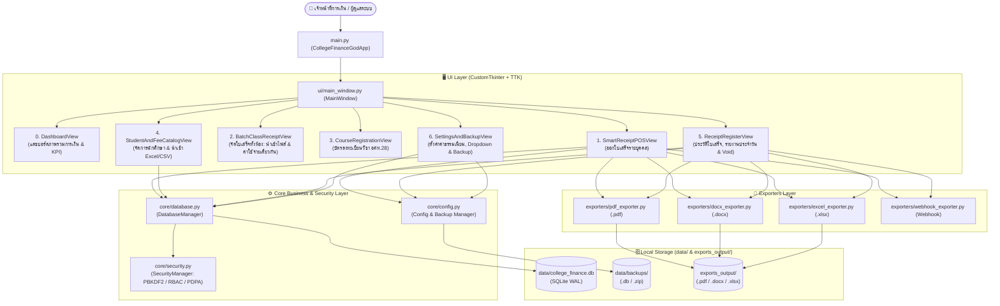

# 📘 เอกสารประกอบโครงการและคู่มือการใช้งานระบบ (Project Documentation & User Manual)
## ระบบออกใบเสร็จรับเงินค่าเทอม วิทยาลัยอาชีวศึกษาสุพรรณบุรี (SPVC Smart Receipt Desktop System)

เอกสารฉบับนี้รวบรวมข้อมูลสถาปัตยกรรมระบบ เทคโนโลยีที่ใช้ (Tech Stack) โครงสร้างโปรเจค (Project Structure) โครงสร้างและตำแหน่งฐานข้อมูล (Database Architecture) ระบบความปลอดภัย (Security) ตลอดจนคู่มือการใช้งานโปรแกรมฉบับสมบูรณ์ (User Manual)

---

## 📑 สารบัญ (Table of Contents)
1. [ภาพรวมของโปรเจค (Project Overview)](#1-ภาพรวมของโปรเจค-project-overview)
2. [เทคโนโลยีและไลบรารีที่ใช้ (Tech Stack)](#2-เทคโนโลยีและไลบรารีที่ใช้-tech-stack)
3. [โครงสร้างโปรเจค (Project Structure)](#3-โครงสร้างโปรเจค-project-structure)
4. [ระบบฐานข้อมูล โครงสร้างตาราง และตำแหน่งที่ตั้ง (Database Architecture)](#4-ระบบฐานข้อมูล-โครงสร้างตาราง-และตำแหน่งที่ตั้ง-database-architecture)
5. [ระบบความปลอดภัยและการตรวจสอบย้อนหลัง (Security & Compliance)](#5-ระบบความปลอดภัยและการตรวจสอบย้อนหลัง-security--compliance)
6. [คู่มือการใช้งานโปรแกรมฉบับสมบูรณ์ (User Manual)](#6-คู่มือการใช้งานโปรแกรมฉบับสมบูรณ์-user-manual)
7. [การแก้ไขปัญหาเบื้องต้น (Troubleshooting & FAQ)](#7-การแก้ไขปัญหาเบื้องต้น-troubleshooting--faq)
8. [มาตรฐานการออกแบบส่วนต่อประสานผู้ใช้ (Clean UI & Single Enclosure Rule)](#8-มาตรฐานการออกแบบส่วนต่อประสานผู้ใช้-clean-ui--single-enclosure-rule)

---

## 1. ภาพรวมของโปรเจค (Project Overview)

**CollegeFinanceGodApp (SPVC Smart Tuition & Flexible Receipt System)** เป็นแอปพลิเคชันแบบ Desktop สำหรับระบบปฏิบัติการ Windows พัฒนาขึ้นเพื่อรองรับงานการเงินและบัญชีของ **วิทยาลัยอาชีวศึกษาสุพรรณบุรี (อศ.สุพรรณบุรี)** โดยมีเป้าหมายหลักคือ:
- ออกใบเสร็จรับเงินค่าเทอมได้ทั้งแบบ **รายบุคคล** และ **แบบเดียวยกห้องเรียน (Batch Classroom Receipts)**
- รองรับการนำเข้ารายชื่อนักเรียน/นักศึกษาจากไฟล์ **Excel (`.xlsx`)** และ **CSV (`.csv`)**
- ส่งออกเอกสารใบเสร็จและรายงานสรุปยอดประจำวันในรูปแบบ **PDF (`.pdf`)**, **Word (`.docx`)** และ **Excel (`.xlsx`)**
- ปรับแต่งรายการค่าธรรมเนียมและตัวเลือก Dropdown ทุกหมวดได้เองผ่านหน้าจอตั้งค่าโดยไม่ต้องแก้ไขโค้ด
- มีความเสถียรและปลอดภัยสูงด้วยฐานข้อมูล **SQLite โหมด WAL (ACID)** พร้อมระบบ **Hash Chain Audit Log** และการสำรองข้อมูลอัตโนมัติ

---

## 2. เทคโนโลยีและไลบรารีที่ใช้ (Tech Stack)

โปรเจคนี้พัฒนาด้วยภาษา **Python 3** โดยแบ่งชุดเทคโนโลยีตามหน้าที่การทำงานดังนี้:

| หมวดหมู่ | เทคโนโลยี / ไลบรารี | หน้าที่การทำงานในระบบ | ไฟล์หลักที่เรียกใช้ |
| :--- | :--- | :--- | :--- |
| **Core Language** | **Python 3.x** | พัฒนา Business Logic, การคำนวณเงิน, และการแปลงเงินเป็นคำอ่านบาทไทย | ทุกไฟล์ในระบบ |
| **Desktop GUI** | **CustomTkinter (`customtkinter`)** | สร้างส่วนติดต่อผู้ใช้ Modern Corporate (ปุ่ม, Entry, Dropdown, Tabs, Dialogs) | `ui/main_window.py`, `ui/views.py` |
| **Data Table UI** | **Tkinter TTK (`ttk.Treeview`)** | ตารางแสดงผลข้อมูลความเร็วสูง (`DataTable`) พร้อม Scrollbar และไฮไลต์สี | `ui/components.py` |
| **Primary Database** | **SQLite 3 (`sqlite3`)** | ฐานข้อมูลหลัก Serverless โหมด WAL รองรับ ACID Transactions | `core/database.py`, `core/config.py` |
| **Enterprise DB** | **PostgreSQL (`psycopg2`)** | รองรับการขยายระบบเป็น Client-Server ผ่านค่า `database_url` ใน config | `core/database.py` |
| **PDF Generator** | **FPDF2 (`fpdf`)** | สร้างใบเสร็จราชการตามแบบ EXofBill (มีตราครุฑ), ใบเสร็จยกห้อง และรายงานสรุปยอด | `exporters/pdf_exporter.py` |
| **Word Generator** | **python-docx (`docx`)** | สร้างใบเสร็จรับเงินและรายงานสรุปยอดประจำวันเป็นไฟล์ Word (.docx) | `exporters/docx_exporter.py` |
| **Excel I/O** | **OpenPyXL (`openpyxl`)** | นำเข้ารายชื่อนักศึกษา (.xlsx) และสร้างรายงานการเงิน 3 ชีต พร้อมจัดรูปแบบสีและตาราง | `core/database.py`, `exporters/excel_exporter.py` |
| **CSV Processing** | **`csv` (Standard Lib)** | อ่านและนำเข้าข้อมูลนักศึกษาจากไฟล์ .csv (รองรับ UTF-8-SIG ภาษาไทยไม่เพี้ยน) | `core/database.py` |
| **Security & Crypto** | **`hashlib`, `os`** | แฮชรหัสผ่าน PBKDF2 (120,000 รอบ), SHA-256 Hash Chain และ PDPA Data Masking | `core/security.py`, `core/database.py` |
| **Backup & Archive** | **`sqlite3.backup`, `zipfile`** | สำรองฐานข้อมูล Online Hot Backup (.db) และบีบอัด Zip Full Backup พร้อมหลักฐาน | `core/config.py` |
| **Webhook / Alert** | **`urllib.request`, `threading`** | ส่งแจ้งเตือนธุรกรรมเบื้องหลัง (Background Thread) ไปยัง LINE, Discord หรือ n8n | `exporters/webhook_exporter.py` |
| **Build & Packaging** | **PyInstaller** | แพ็กเกจแอปพลิเคชันเป็นไฟล์ Executable (.exe) สำหรับใช้งานบน Windows ทันที | `CollegeFinanceGodApp.spec` |
| **Testing** | **`unittest`, PIL** | ชุดทดสอบระบบอัตโนมัติ (Automated Unit & Integration Test Suite) | `test_suite.py` |

---

## 3. โครงสร้างโปรเจค (Project Structure)

```text
CollegeFinanceGodApp/
├── main.py                        # จุดเริ่มต้นการทำงานของโปรแกรม (Application Entry Point & Controller)
├── config.json                    # ไฟล์ตั้งค่าระบบ (ชื่อสถานศึกษา, เล่มที่/ช่วงเลขที่ใบเสร็จ, โฟลเดอร์ส่งออก ฯลฯ)
├── Run_SPVC_Receipt.bat           # ไฟล์ Batch สำหรับดับเบิลคลิกเปิดโปรแกรมบน Windows
├── SPVC_Receipt_App.exe           # ไฟล์ Executable (.exe) สำหรับเปิดโปรแกรมโดยตรงหรือทำ Shortcut บน Desktop
├── CollegeFinanceGodApp.spec      # ไฟล์ตั้งค่าสำหรับสั่ง Build โปรแกรมเป็น .exe ด้วย PyInstaller
├── test_suite.py                  # ชุดทดสอบระบบอัตโนมัติ (Unit & Integration Tests)
├── README.md                      # เอกสารแนะนำโปรเจคฉบับย่อ
├── DOCUMENTATION.md               # เอกสารประกอบโครงการและคู่มือการใช้งานฉบับสมบูรณ์ (ไฟล์นี้)
│
├── core/                          # 📦 โมดูลหลักด้านฐานข้อมูล ความปลอดภัย และการตั้งค่า (Backend Core)
│   ├── __init__.py
│   ├── config.py                  # โหลด/บันทึก config.json, แปลงเลขเป็นคำอ่านบาทไทย, สำรองและกู้คืนฐานข้อมูล
│   ├── database.py                # DatabaseManager: จัดการ SQLite WAL, CRUD นักศึกษา, ออกใบเสร็จ, Audit Log
│   ├── models.py                  # Data Models (UserSession, StudentRecord, TransactionRecord)
│   └── security.py                # SecurityManager: PBKDF2 Password Hashing, RBAC Permissions, PDPA Masking
│
├── ui/                            # 🖥️ โมดูลส่วนติดต่อผู้ใช้งาน (Frontend Desktop GUI)
│   ├── __init__.py
│   ├── theme.py                   # AppTheme: ระบบธีมทางการ สไตล์เหลี่ยมคมล้วน ไม่เอามน (Pure Flat Rectangular 0-Radius), โทนสี Navy & Slate
│   ├── icon_manager.py            # IconManager: จัดการชุดไอคอนเวกเตอร์ PNG ความคมชัดสูง ไร้อีโมจิ สำหรับ Sidebar
│   ├── components.py              # Reusable UI Widgets: StatCard, SectionHeader, DataTable (Treeview)
│   ├── login_window.py            # LoginWindow: หน้าจอเข้าสู่ระบบและสลับบัญชีเจ้าหน้าที่
│   ├── main_window.py             # MainWindow: หน้าต่างหลักพร้อมแถบเมนูข้าง (Sidebar) ปรับกว้าง 275px + ปุ่มกดหด/ขยายได้ (Collapsible 72px/275px)
│   ├── dashboard_view.py          # DashboardView: แดชบอร์ดภาพรวมการเงิน สถิติ และตัวชี้วัด (Executive Financial Dashboard)
│   ├── batch_class_view.py        # BatchClassReceiptView: จัดใบเสร็จทั้งห้อง (นำเข้าไฟล์ Excel/CSV & ค่าใช้จ่ายเดียวกัน)
│   └── views.py                   # หน้าจอการทำงานหลัก:
│                                  #   1. SmartReceiptPOSView (หน้าออกใบเสร็จรายบุคคล)
│                                  #   2. CourseRegistrationView (หน้าพิมพ์บัตรลงทะเบียนวิชา อศท.28)
│                                  #   3. StudentAndFeeCatalogView (หน้าจัดการรายชื่อนักศึกษา & นำเข้า Excel/CSV)
│                                  #   4. ReceiptRegisterView (หน้าประวัติใบเสร็จ, รายงานประจำวัน & ยกเลิกใบเสร็จ)
│                                  #   5. SettingsAndBackupView (หน้าตั้งค่าค่าธรรมเนียม, Dropdown & สำรองข้อมูล)
│
├── exporters/                     # 📄 โมดูลส่งออกเอกสารและแจ้งเตือน (Document & Report Exporters)
│   ├── __init__.py
│   ├── base.py                    # BaseFinanceExporter: Abstract Base Class สำหรับตัวส่งออกรายงาน
│   ├── pdf_exporter.py            # PdfReceiptExporter: สร้างใบเสร็จรับเงินและรายงานประจำวันเป็นไฟล์ .pdf
│   ├── docx_exporter.py           # DocxReceiptExporter: สร้างใบเสร็จรับเงินและรายงานประจำวันเป็นไฟล์ .docx
│   ├── excel_exporter.py          # ExcelFinanceExporter: สร้างรายงานสรุปการเงิน, แดชบอร์ด และลูกหนี้เป็นไฟล์ .xlsx
│   └── webhook_exporter.py        # FinanceWebhookDispatcher: ส่งแจ้งเตือนเข้า Webhook (n8n / LINE / Discord)
│
├── data/                          # 🗄️ โฟลเดอร์เก็บฐานข้อมูลและไฟล์สำรอง
│   ├── college_finance.db         # ไฟล์ฐานข้อมูลหลัก (SQLite 3 Database)
│   ├── backups/                   # โฟลเดอร์เก็บไฟล์สำรองฐานข้อมูล (.db และ .zip)
│   └── evidence/                  # โฟลเดอร์เก็บรูปภาพหลักฐาน/สลิปการโอนเงิน
│
├── exports_output/                # 📂 โฟลเดอร์เริ่มต้นสำหรับบันทึกไฟล์ใบเสร็จ (.pdf, .docx) และรายงาน (.xlsx)
└── EX/                            # 🖼️ โฟลเดอร์ภาพตัวอย่างหน้าจอและใบเสร็จต้นฉบับของวิทยาลัยฯ สำหรับอ้างอิง
```

### แผนผังการทำงานของระบบ (System Architecture Diagram)



---

## 4. ระบบฐานข้อมูล โครงสร้างตาราง และตำแหน่งที่ตั้ง (Database Architecture)

### 4.1 ฐานข้อมูลอยู่ที่ไหน? (Database Location)
ข้อมูลทั้งหมดถูกจัดเก็บไว้ภายในเครื่องคอมพิวเตอร์ (Local Storage) โดยไม่ต้องพึ่งพาอินเทอร์เน็ต ตามตำแหน่งต่อไปนี้:
1. **ไฟล์ฐานข้อมูลหลัก**:
   - พาธเต็ม: `D:\111Work\1111111\CollegeFinanceGodApp\data\college_finance.db`
   - ชนิดฐานข้อมูล: **SQLite 3** (สร้างตารางและข้อมูลเริ่มต้นให้อัตโนมัติเมื่อเปิดโปรแกรมครั้งแรก)
2. **โฟลเดอร์เก็บไฟล์สำรองฐานข้อมูล (Backups)**:
   - พาธเต็ม: `D:\111Work\1111111\CollegeFinanceGodApp\data\backups\`
   - เก็บไฟล์สำรองอัตโนมัติเมื่อปิดโปรแกรม (`spvc_receipt_backup_YYYYMMDD_HHMMSS.db`) และไฟล์สำรองแบบเต็ม (`SPVC_FullBackup_YYYYMMDD_HHMMSS.zip`)
3. **โฟลเดอร์เก็บหลักฐานการชำระเงิน (Evidence)**:
   - พาธเต็ม: `D:\111Work\1111111\CollegeFinanceGodApp\data\evidence\`

### 4.2 การปรับจูนประสิทธิภาพฐานข้อมูล (SQLite PRAGMA Optimization)
ทุกครั้งที่มีการเชื่อมต่อฐานข้อมูลใน `DatabaseManager._connect()` ระบบจะสั่งตั้งค่า SQLite ผ่านคำสั่ง PRAGMA ดังนี้:

| คำสั่ง PRAGMA | ค่าที่กำหนด | ประโยชน์และการทำงานในระบบ |
| :--- | :--- | :--- |
| `PRAGMA foreign_keys = ON;` | `ON` | บังคับใช้ Foreign Key Constraints เช่น เมื่อลบใบเสร็จหลัก รายการย่อยจะถูกลบตามอัตโนมัติ (`ON DELETE CASCADE`) |
| `PRAGMA journal_mode = WAL;` | `WAL` | เปิด Write-Ahead Logging ช่วยให้อ่านและเขียนข้อมูลพร้อมกันได้รวดเร็ว ป้องกัน `database is locked` และข้อมูลปลอดภัยหากไฟดับ |
| `PRAGMA synchronous = NORMAL;` | `NORMAL` | เพิ่มความเร็วการเขียนข้อมูลลงดิสก์อย่างปลอดภัยตามมาตรฐาน WAL |
| `PRAGMA cache_size = -64000;` | `-64000` (64 MB) | จัดสรรหน่วยความจำ Cache RAM ขนาด 64 MB ช่วยให้การค้นหาและกรองข้อมูลลื่นไหล |
| `PRAGMA temp_store = MEMORY;` | `MEMORY` | จัดเก็บตารางชั่วคราวและการจัดเรียง (Order By / Group By) ไว้ใน RAM |

---

### 4.3 ตารางภาพรวมฐานข้อมูล (Database Schema Overview - 11 ตาราง)

| ลำดับ | ชื่อตาราง (Table Name) | คำอธิบายหน้าที่การทำงานในระบบ | Primary Key | ตารางที่เชื่อมโยง (Relations) |
| :---: | :--- | :--- | :--- | :--- |
| 1 | `master_options` | จัดเก็บตัวเลือก Dropdown ทั้ง 6 หมวดในระบบ | `id` | - |
| 2 | `academic_terms` | ข้อมูลภาคเรียนและปีการศึกษา และกำหนดภาคเรียนปัจจุบัน | `id` | อ้างอิงใน `students`, `receipts`, `student_enrollments` |
| 3 | `users` | บัญชีผู้ใช้งานระบบ รหัสผ่านแฮช PBKDF2 และสิทธิ์ RBAC | `id` | เชื่อมโยงกับ `receipts` (ผู้รับเงิน) และ `audit_logs` (ผู้กระทำ) |
| 4 | `students` | ทะเบียนประวัตินักศึกษา ชั้นปี สาขา และยอดหนี้สะสม | `id` | เชื่อมต่อไปยัง `student_enrollments`, `receipts`, `student_course_registrations` |
| 5 | `fee_catalog` | แคตตาล็อกรายการค่าธรรมเนียมตาม 6 หมวดหลักสูตร | `id` | ใช้อ้างอิงในหน้าออกใบเสร็จและ `receipt_items` |
| 6 | `student_enrollments` | ข้อมูลการลงทะเบียน ยอดค่าเทอม ส่วนลด และยอดค้างชำระรายภาค | `id` | เชื่อม `students.id` (`ON DELETE CASCADE`) |
| 7 | `receipts` | บันทึกหัวใบเสร็จรับเงิน (Master Receipt) และ Snapshot ข้อมูล ณ เวลาออกบิล | `id` | เชื่อมต่อไปยัง `receipt_items`, `students` |
| 8 | `receipt_items` | รายการค่าธรรมเนียมย่อยแต่ละแถวในใบเสร็จรับเงิน | `id` | เชื่อม `receipts.id` (`ON DELETE CASCADE`) |
| 9 | `audit_logs` | ประวัติการดำเนินงานทุกธุรกรรมแบบ Tamper-Evident SHA-256 Hash Chain | `id` | บันทึกชื่อและสิทธิ์ผู้ใช้งานจาก `users` |
| 10 | `course_catalog` | คลังรายวิชาสำหรับพิมพ์บัตรลงทะเบียน (อศท.28) | `id` | ใช้เลือกวิชาเข้า `student_course_registrations` |
| 11 | `student_course_registrations` | รายการวิชาที่นักศึกษาลงทะเบียนในภาคเรียน (อศท.28) | `id` | เชื่อมโยงรหัสนักศึกษา `students.student_code` |

---

### 4.4 โครงสร้างคอลัมน์ของแต่ละตารางอย่างละเอียด (Detailed Table Schemas)

#### 4.4.1 ตาราง `master_options` (ตัวเลือก Dropdown ระบบ)
ใช้เก็บตัวเลือกสำหรับ Dropdown ทุกหมวดในโปรแกรม เช่น หลักสูตร, คณะ, สาขา, ห้องเรียน, ภาคเรียน, ตำแหน่งผู้รับเงิน

| ลำดับ | ชื่อคอลัมน์ (Column) | ประเภทข้อมูล (Type) | ข้อกำหนด (Constraints) | ค่าเริ่มต้น (Default) | คำอธิบาย (Description) |
| :---: | :--- | :--- | :--- | :--- | :--- |
| 1 | `id` | INTEGER | PRIMARY KEY AUTOINCREMENT | - | รหัสไอดีลำดับอัตโนมัติ |
| 2 | `category` | TEXT | NOT NULL | - | หมวดหมู่ เช่น `CURRICULUM`, `FACULTY`, `DEPARTMENT`, `CLASS_LEVEL`, `TERM`, `CASHIER_POSITION` |
| 3 | `option_value` | TEXT | NOT NULL | - | ข้อความค่าตัวเลือกที่แสดงใน Dropdown |
| 4 | `sort_order` | INTEGER | - | `10` | ลำดับการแสดงผลใน Dropdown (ค่าน้อยแสดงก่อน) |

> **ข้อกำหนดเฉพาะ**: `UNIQUE(category, option_value)` ป้องกันชื่อตัวเลือกซ้ำในหมวดเดียวกัน

#### 4.4.2 ตาราง `academic_terms` (ภาคและปีการศึกษา)
ใช้กำหนดภาคเรียนและปีการศึกษา เช่น `1/2569`, `2/2569`

| ลำดับ | ชื่อคอลัมน์ (Column) | ประเภทข้อมูล (Type) | ข้อกำหนด (Constraints) | ค่าเริ่มต้น (Default) | คำอธิบาย (Description) |
| :---: | :--- | :--- | :--- | :--- | :--- |
| 1 | `id` | INTEGER | PRIMARY KEY AUTOINCREMENT | - | รหัสไอดีลำดับอัตโนมัติ |
| 2 | `term_code` | TEXT | UNIQUE NOT NULL | - | รหัสภาคเรียน เช่น `1/2569`, `2/2569` |
| 3 | `term_name` | TEXT | NOT NULL | - | ชื่อภาคเรียน เช่น `ภาคเรียนที่ 1 ปีการศึกษา 2569` |
| 4 | `is_current` | INTEGER | - | `0` | สถานะภาคเรียนปัจจุบัน (`1` = ภาคเรียนปัจจุบัน, `0` = ภาคเรียนอื่น) |

#### 4.4.3 ตาราง `users` (ผู้ใช้งานระบบและการยืนยันตัวตน)
เก็บบัญชีผู้ใช้งาน รหัสผ่านแฮช และระดับสิทธิ์

| ลำดับ | ชื่อคอลัมน์ (Column) | ประเภทข้อมูล (Type) | ข้อกำหนด (Constraints) | ค่าเริ่มต้น (Default) | คำอธิบาย (Description) |
| :---: | :--- | :--- | :--- | :--- | :--- |
| 1 | `id` | INTEGER | PRIMARY KEY AUTOINCREMENT | - | รหัสไอดีลำดับอัตโนมัติ |
| 2 | `username` | TEXT | UNIQUE NOT NULL | - | ชื่อผู้ใช้สำหรับเข้าสู่ระบบ |
| 3 | `password_hash` | TEXT | NOT NULL | - | รหัสผ่านที่เข้ารหัสด้วย PBKDF2-HMAC-SHA256 (`salt$hash`) |
| 4 | `full_name` | TEXT | NOT NULL | - | ชื่อ-นามสกุลจริงของเจ้าหน้าที่ |
| 5 | `position` | TEXT | - | `'ครู'` | ตำแหน่งราชการ เช่น ครู, เจ้าหน้าที่การเงิน |
| 6 | `role` | TEXT | NOT NULL | `'ADMIN'` | ระดับสิทธิ์: `ADMIN`, `FINANCE`, `AUDITOR` |
| 7 | `department` | TEXT | NOT NULL | `'งานการเงินและบัญชี'` | หน่วยงาน/ฝ่ายที่สังกัด |
| 8 | `active` | INTEGER | - | `1` | สถานะการใช้งาน (`1` = เปิดใช้งาน, `0` = ปิดการใช้งาน) |

#### 4.4.4 ตาราง `students` (ทะเบียนประวัตินักศึกษา)
เก็บข้อมูลนักศึกษา สถานะการเรียน ค่าเทอมรวม ยอดชำระ และสถานะชำระเงิน

| ลำดับ | ชื่อคอลัมน์ (Column) | ประเภทข้อมูล (Type) | ข้อกำหนด (Constraints) | ค่าเริ่มต้น (Default) | คำอธิบาย (Description) |
| :---: | :--- | :--- | :--- | :--- | :--- |
| 1 | `id` | INTEGER | PRIMARY KEY AUTOINCREMENT | - | รหัสไอดีลำดับอัตโนมัติ |
| 2 | `student_code` | TEXT | UNIQUE NOT NULL | - | รหัสประจำตัวนักศึกษา เช่น `692020101` |
| 3 | `full_name` | TEXT | NOT NULL | - | ชื่อและนามสกุลนักศึกษา |
| 4 | `citizen_id` | TEXT | NOT NULL | `''` | เลขประจำตัวประชาชน 13 หลัก |
| 5 | `education_level` | TEXT | NOT NULL | `'ปวช.1'` | ระดับชั้น เช่น `ปวช.1`, `ปวช.2`, `ปวส.1`, `ปวส.2` |
| 6 | `class_group` | TEXT | NOT NULL | `'ปวช.1/1'` | ห้องเรียน/กลุ่มเรียน เช่น `ปวช.1/1` |
| 7 | `faculty` | TEXT | NOT NULL | `'พาณิชยกรรม'` | คณะ / ประเภทวิชา |
| 8 | `major` | TEXT | NOT NULL | `'การบัญชี'` | แผนกวิชา / สาขาวิชา |
| 9 | `year_level` | INTEGER | NOT NULL | `1` | ชั้นปีที่กำลังศึกษา (`1`, `2`, `3`, `4`) |
| 10 | `scholarship_type` | TEXT | - | `'ปกติ (Regular)'` | ประเภททุน/สิทธิ เช่น ปกติ, เรียนฟรี 15 ปี (ปวช.) |
| 11 | `registered_credits` | INTEGER | NOT NULL | `20` | จำนวนหน่วยกิตที่ลงทะเบียนรวม |
| 12 | `total_fee` | REAL | NOT NULL | `0.0` | ค่าเทอมประเมินรวม (บาท) |
| 13 | `paid_amount` | REAL | NOT NULL | `0.0` | ยอดเงินที่ชำระสะสมแล้ว (บาท) |
| 14 | `status` | TEXT | NOT NULL | `'UNPAID'` | สถานะชำระ: `PAID` (ครบ), `PARTIAL` (บางส่วน), `UNPAID` (ค้างชำระ) |
| 15 | `phone` | TEXT | - | `''` | หมายเลขโทรศัพท์ติดต่อ |

#### 4.4.5 ตาราง `fee_catalog` (คลังรายการค่าธรรมเนียมการศึกษา)
เก็บแคตตาล็อกรายการค่าใช้จ่ายแยกตาม 6 หมวดหลักสูตร

| ลำดับ | ชื่อคอลัมน์ (Column) | ประเภทข้อมูล (Type) | ข้อกำหนด (Constraints) | ค่าเริ่มต้น (Default) | คำอธิบาย (Description) |
| :---: | :--- | :--- | :--- | :--- | :--- |
| 1 | `id` | INTEGER | PRIMARY KEY AUTOINCREMENT | - | รหัสไอดีลำดับอัตโนมัติ |
| 2 | `fee_code` | TEXT | UNIQUE NOT NULL | - | รหัสรายการ เช่น `SPVC-01`, `SPVC-21` |
| 3 | `curriculum_name` | TEXT | NOT NULL | `'หลักสูตรในระบบ-ปวช'` | ชื่อหลักสูตร (มี 6 หลักสูตรตามแบบฟอร์ม EX) |
| 4 | `fee_name` | TEXT | NOT NULL | - | ชื่อรายการค่าธรรมเนียม เช่น `ค่าบำรุงการศึกษา`, `ค่าวัสดุฝึก` |
| 5 | `calc_type` | TEXT | NOT NULL | `'FIXED'` | ประเภทการคิดเงิน: `FIXED` (เหมาจ่าย) หรือ `PER_CREDIT` (ตามหน่วยกิต) |
| 6 | `default_credits` | REAL | NOT NULL | `0.0` | จำนวนหน่วยกิตเริ่มต้น |
| 7 | `default_price` | REAL | NOT NULL | `0.0` | ราคาต่อหน่วยเริ่มต้น (บาท) |
| 8 | `education_level` | TEXT | NOT NULL | `'ALL'` | ระดับชั้นที่ใช้รายการนี้ได้ เช่น `ALL`, `ปวช.`, `ปวส.` |
| 9 | `is_waivable_15yr` | INTEGER | - | `0` | สิทธิเรียนฟรี 15 ปี (`1` = ได้รับยกเว้น, `0` = ไม่ได้รับยกเว้น) |
| 10 | `sort_order` | INTEGER | - | `10` | ลำดับการแสดงผลในหน้าจอ |
| 11 | `is_active` | INTEGER | - | `1` | สถานะการใช้งาน (`1` = ใช้งาน, `0` = ระงับ) |

#### 4.4.6 ตาราง `student_enrollments` (การลงทะเบียนและยอดหนี้รายภาคเรียน)
บันทึกประวัติการลงทะเบียน ยอดค่าเทอม ส่วนลด และยอดค้างชำระของนักศึกษาในแต่ละภาคเรียน

| ลำดับ | ชื่อคอลัมน์ (Column) | ประเภทข้อมูล (Type) | ข้อกำหนด (Constraints) | ค่าเริ่มต้น (Default) | คำอธิบาย (Description) |
| :---: | :--- | :--- | :--- | :--- | :--- |
| 1 | `id` | INTEGER | PRIMARY KEY AUTOINCREMENT | - | รหัสไอดีลำดับอัตโนมัติ |
| 2 | `student_id` | INTEGER | NOT NULL, FOREIGN KEY | - | รหัสไอดีนักศึกษา อ้างอิง `students(id)` ON DELETE CASCADE |
| 3 | `term_code` | TEXT | NOT NULL | - | รหัสภาคเรียน เช่น `1/2569` |
| 4 | `registered_credits` | INTEGER | NOT NULL | `20` | จำนวนหน่วยกิตที่ลงทะเบียนในภาคนั้น |
| 5 | `total_fee` | REAL | NOT NULL | `0.0` | ค่าเทอมรวมก่อนหักส่วนลด (บาท) |
| 6 | `discount_amount` | REAL | NOT NULL | `0.0` | ส่วนลดค่าเทอมหรือทุนที่ได้รับ (บาท) |
| 7 | `net_fee` | REAL | NOT NULL | `0.0` | ยอดค่าเทอมสุทธิที่ต้องชำระ (บาท) |
| 8 | `paid_amount` | REAL | NOT NULL | `0.0` | ยอดเงินที่ชำระแล้วในภาคนั้น (บาท) |
| 9 | `balance_amount` | REAL | NOT NULL | `0.0` | ยอดหนี้ค้างชำระคงเหลือ (บาท) |
| 10 | `payment_status` | TEXT | NOT NULL | `'UNPAID'` | สถานะ: `PAID`, `PARTIAL`, `UNPAID` |
| 11 | `note` | TEXT | - | `''` | บันทึกช่วยจำเพิ่มเติม |

> **ข้อกำหนดเฉพาะ**: `UNIQUE(student_id, term_code)` นักศึกษา 1 คน ลงทะเบียนได้ 1 ครั้งต่อ 1 ภาคเรียน

#### 4.4.7 ตาราง `receipts` (หัวใบเสร็จรับเงิน Master Receipt)
บันทึกข้อมูลหลักของใบเสร็จรับเงิน พร้อมเก็บ Snapshot ข้อมูลผู้ชำระ ณ เวลาที่ออกบิล

| ลำดับ | ชื่อคอลัมน์ (Column) | ประเภทข้อมูล (Type) | ข้อกำหนด (Constraints) | ค่าเริ่มต้น (Default) | คำอธิบาย (Description) |
| :---: | :--- | :--- | :--- | :--- | :--- |
| 1 | `id` | INTEGER | PRIMARY KEY AUTOINCREMENT | - | รหัสไอดีลำดับอัตโนมัติ |
| 2 | `receipt_no` | TEXT | UNIQUE NOT NULL | - | เลขที่ใบเสร็จรับเงิน เช่น `700605433` |
| 3 | `book_no` | TEXT | NOT NULL | `'7006'` | เล่มที่ใบเสร็จรับเงิน |
| 4 | `receipt_date` | TEXT | NOT NULL | - | วันที่ออกใบเสร็จ (รูปแบบ วว/ดด/ปปปป พ.ศ.) |
| 5 | `term_code` | TEXT | NOT NULL | `'1/2569'` | ภาคเรียนและปีการศึกษา |
| 6 | `student_id` | INTEGER | - | NULL | รหัสไอดีนักศึกษา (ถ้ามีในระบบ) |
| 7 | `student_code` | TEXT | NOT NULL | - | รหัสประจำตัวนักศึกษา |
| 8 | `snapshot_student_name` | TEXT | NOT NULL | - | ชื่อ-สกุล ผู้ชำระ ณ เวลาออกบิล (ป้องกันประวัติเปลี่ยน) |
| 9 | `snapshot_education_level` | TEXT | NOT NULL | `'ปวช.1'` | ระดับชั้น ณ เวลาออกบิล |
| 10 | `snapshot_class_group` | TEXT | NOT NULL | `''` | ห้องเรียน ณ เวลาออกบิล |
| 11 | `snapshot_department` | TEXT | NOT NULL | `''` | คณะ ณ เวลาออกบิล |
| 12 | `snapshot_major` | TEXT | NOT NULL | `''` | แผนกวิชา / สาขา ณ เวลาออกบิล |
| 13 | `subtotal_amount` | REAL | NOT NULL | `0.0` | ยอดรวมเงินก่อนส่วนลด (บาท) |
| 14 | `discount_amount` | REAL | NOT NULL | `0.0` | ส่วนลดรวม (บาท) |
| 15 | `net_total_amount` | REAL | NOT NULL | `0.0` | ยอดรับเงินสุทธิ (บาท) |
| 16 | `amount_text_th` | TEXT | NOT NULL | `''` | คำอ่านจำนวนเงินบาทไทย เช่น `(หนึ่งพันหนึ่งร้อยสามสิบบาทถ้วน)` |
| 17 | `payment_method` | TEXT | NOT NULL | `'เงินสด (Cash)'` | ช่องทางชำระเงิน เช่น เงินสด, QR PromptPay, โอนเงินธนาคาร |
| 18 | `payment_ref` | TEXT | - | `''` | หมายเลขอ้างอิงการทำรายการ / สลิปโอนเงิน |
| 19 | `evidence_path` | TEXT | - | `''` | ที่อยู่ไฟล์ภาพสลิปหลักฐานในเครื่อง |
| 20 | `cashier_username` | TEXT | NOT NULL | `'admin'` | บัญชีผู้ใช้งานของผู้รับเงิน |
| 21 | `cashier_name` | TEXT | NOT NULL | `'เจ้าหน้าที่การเงิน'` | ชื่อ-นามสกุล ของผู้ลงนามรับเงิน |
| 22 | `cashier_position` | TEXT | NOT NULL | `'ครู'` | ตำแหน่งราชการของผู้ลงนาม เช่น ครู, เจ้าหน้าที่การเงิน |
| 23 | `status` | TEXT | NOT NULL | `'ISSUED'` | สถานะใบเสร็จ: `ISSUED` (ปกติ) หรือ `VOIDED` (ยกเลิก) |
| 24 | `void_reason` | TEXT | - | `''` | เหตุผลในการยกเลิกใบเสร็จ |
| 25 | `voided_at` | TEXT | - | `''` | วันและเวลาที่ทำรายการยกเลิก (ISO Format) |
| 26 | `voided_by` | TEXT | - | `''` | บัญชีผู้ใช้ที่กดยกเลิกใบเสร็จ |
| 27 | `printed_count` | INTEGER | - | `1` | จำนวนครั้งที่สั่งพิมพ์เอกสารใบเสร็จ |
| 28 | `remark` | TEXT | - | `''` | หมายเหตุท้ายใบเสร็จ |

#### 4.4.8 ตาราง `receipt_items` (รายการค่าธรรมเนียมย่อยในใบเสร็จ)
บันทึกแต่ละแถวของรายการค่าใช้จ่ายที่ปรากฏในใบเสร็จ

| ลำดับ | ชื่อคอลัมน์ (Column) | ประเภทข้อมูล (Type) | ข้อกำหนด (Constraints) | ค่าเริ่มต้น (Default) | คำอธิบาย (Description) |
| :---: | :--- | :--- | :--- | :--- | :--- |
| 1 | `id` | INTEGER | PRIMARY KEY AUTOINCREMENT | - | รหัสไอดีลำดับอัตโนมัติ |
| 2 | `receipt_id` | INTEGER | NOT NULL, FOREIGN KEY | - | รหัสอ้างอิงใบเสร็จ `receipts(id)` ON DELETE CASCADE |
| 3 | `line_no` | INTEGER | NOT NULL | `1` | ลำดับที่ของแถวในใบเสร็จ (1, 2, 3...) |
| 4 | `fee_code` | TEXT | NOT NULL | `'CUSTOM'` | รหัสรายการค่าธรรมเนียม |
| 5 | `curriculum_name` | TEXT | NOT NULL | `''` | ชื่อหลักสูตรของรายการ |
| 6 | `item_name` | TEXT | NOT NULL | - | ชื่อรายการค่าใช้จ่าย เช่น `ค่าบำรุงการศึกษา` |
| 7 | `quantity` | REAL | NOT NULL | `1.0` | จำนวนหน่วย / หน่วยกิต |
| 8 | `unit_price` | REAL | NOT NULL | `0.0` | ราคาต่อ 1 หน่วย (บาท) |
| 9 | `discount` | REAL | NOT NULL | `0.0` | ส่วนลดเฉพาะรายการนี้ (บาท) |
| 10 | `line_total` | REAL | NOT NULL | `0.0` | ยอดเงินรวมของแถวนี้ (บาท) |

#### 4.4.9 ตาราง `audit_logs` (ประวัติการกระทำและตรวจสอบย้อนหลัง)
บันทึกทุกธุรกรรมสำคัญทางการเงิน ผูกแฮช SHA-256 เป็นลูกโซ่แบบ Tamper-Evident

| ลำดับ | ชื่อคอลัมน์ (Column) | ประเภทข้อมูล (Type) | ข้อกำหนด (Constraints) | ค่าเริ่มต้น (Default) | คำอธิบาย (Description) |
| :---: | :--- | :--- | :--- | :--- | :--- |
| 1 | `id` | INTEGER | PRIMARY KEY AUTOINCREMENT | - | รหัสไอดีลำดับอัตโนมัติ |
| 2 | `timestamp` | TEXT | NOT NULL | - | วันและเวลาที่เกิดเหตุการณ์ (ISO 8601 เช่น `2026-11-09T14:30:00`) |
| 3 | `actor` | TEXT | NOT NULL | - | ชื่อผู้ใช้งานที่กระทำการ |
| 4 | `role` | TEXT | NOT NULL | - | ระดับสิทธิ์ของผู้กระทำ เช่น `ADMIN`, `FINANCE` |
| 5 | `action` | TEXT | NOT NULL | - | ประเภทกิจกรรม เช่น `RECEIPT_ISSUED`, `RECEIPT_VOID`, `STUDENT_BULK_IMPORT` |
| 6 | `target` | TEXT | NOT NULL | - | เป้าหมาย เช่น เลขที่ใบเสร็จ `700605433` หรือ รหัสเด็ก `692020101` |
| 7 | `detail` | TEXT | NOT NULL | - | รายละเอียดของกิจกรรม |
| 8 | `prev_hash` | TEXT | NOT NULL | - | ค่า SHA-256 Hash ของแถวก่อนหน้า (Genesis: `GENESIS_0000000000000000`) |
| 9 | `curr_hash` | TEXT | NOT NULL | - | ค่า SHA-256 Hash ของแถวปัจจุบัน (คำนวณจากข้อมูลในแถวรวมกับ `prev_hash`) |

#### 4.4.10 ตาราง `course_catalog` (คลังรายวิชาสำหรับบัตรลงทะเบียน อศท.28)
ใช้จัดเก็บรายวิชาตามหลักสูตร สำหรับเลือกพิมพ์ลงในบัตรลงทะเบียนวิชา (แบบ อศท.28)

| ลำดับ | ชื่อคอลัมน์ (Column) | ประเภทข้อมูล (Type) | ข้อกำหนด (Constraints) | ค่าเริ่มต้น (Default) | คำอธิบาย (Description) |
| :---: | :--- | :--- | :--- | :--- | :--- |
| 1 | `id` | INTEGER | PRIMARY KEY AUTOINCREMENT | - | รหัสไอดีลำดับอัตโนมัติ |
| 2 | `course_code` | TEXT | UNIQUE NOT NULL | - | รหัสวิชา เช่น `20204-2001` |
| 3 | `course_name` | TEXT | NOT NULL | - | ชื่อวิชา เช่น `การเขียนโปรแกรมคอมพิวเตอร์` |
| 4 | `theory_hours` | INTEGER | NOT NULL | `0` | จำนวนชั่วโมงทฤษฎีต่อสัปดาห์ (ท.) |
| 5 | `practice_hours` | INTEGER | NOT NULL | `2` | จำนวนชั่วโมงปฏิบัติต่อสัปดาห์ (ป.) |
| 6 | `credits` | INTEGER | NOT NULL | `1` | จำนวนหน่วยกิต (น.) |
| 7 | `major` | TEXT | NOT NULL | `'เทคโนโลยีธุรกิจดิจิทัล'` | สาขาวิชาที่เปิดสอน |
| 8 | `class_level` | TEXT | NOT NULL | `'ปวช.1'` | ระดับชั้นที่เปิดสอน |
| 9 | `sort_order` | INTEGER | - | `10` | ลำดับการแสดงผล |

#### 4.4.11 ตาราง `student_course_registrations` (รายการวิชาที่ลงทะเบียน อศท.28)
เก็บบันทึกวิชาที่นักศึกษาแต่ละคนลงทะเบียนในแต่ละภาคเรียนสำหรับพิมพ์แบบฟอร์ม อศท.28

| ลำดับ | ชื่อคอลัมน์ (Column) | ประเภทข้อมูล (Type) | ข้อกำหนด (Constraints) | ค่าเริ่มต้น (Default) | คำอธิบาย (Description) |
| :---: | :--- | :--- | :--- | :--- | :--- |
| 1 | `id` | INTEGER | PRIMARY KEY AUTOINCREMENT | - | รหัสไอดีลำดับอัตโนมัติ |
| 2 | `student_code` | TEXT | NOT NULL | - | รหัสประจำตัวนักศึกษา |
| 3 | `term_code` | TEXT | NOT NULL | `'2/2569'` | ภาคเรียนที่ลงทะเบียน |
| 4 | `line_no` | INTEGER | NOT NULL | `1` | ลำดับที่ของวิชาในบัตรลงทะเบียน (1, 2, 3...) |
| 5 | `course_code` | TEXT | NOT NULL | - | รหัสวิชา |
| 6 | `course_name` | TEXT | NOT NULL | - | ชื่อวิชา |
| 7 | `theory_hours` | INTEGER | NOT NULL | `0` | จำนวนชั่วโมงทฤษฎี |
| 8 | `practice_hours` | INTEGER | NOT NULL | `2` | จำนวนชั่วโมงปฏิบัติ |
| 9 | `credits` | INTEGER | NOT NULL | `1` | จำนวนหน่วยกิต |

---

### 4.5 ดัชนีเพื่อเพิ่มประสิทธิภาพการสืบค้น (Database Indexes - 8 Indexes)
เพื่อรองรับข้อมูลจำนวนหลายแสนรายการให้ค้นหาได้รวดเร็วทันใจ ระบบสร้าง Index ต่อไปนี้:

| ลำดับ | ชื่อดัชนี (Index Name) | อยู่บนตาราง (Table) | คอลัมน์ที่ทำดัชนี (Indexed Columns) | วัตถุประสงค์เพื่อประสิทธิภาพ (Purpose) |
| :---: | :--- | :--- | :--- | :--- |
| 1 | `idx_master_options_cat` | `master_options` | `category, sort_order` | ดึงตัวเลือก Dropdown ตามหมวดหมู่อย่างรวดเร็ว |
| 2 | `idx_students_code_name` | `students` | `student_code, full_name, class_group, status` | ค้นหานักศึกษาแบบ Real-time และกรองห้อง/สถานะ |
| 3 | `idx_students_dept_level` | `students` | `education_level, faculty, major` | กรองตามระดับชั้น คณะ และแผนกวิชาในแดชบอร์ด |
| 4 | `idx_students_status_fee` | `students` | `status, total_fee, paid_amount` | คำนวณสรุปยอดหนี้และอัตราจัดเก็บค่าเทอมในแดชบอร์ด |
| 5 | `idx_students_class_code` | `students` | `class_group, student_code` | ดึงรายชื่อนักศึกษายกห้องเรียน (Batch Receipts) |
| 6 | `idx_students_major_code` | `students` | `major, student_code` | ค้นหาและจัดกลุ่มนักศึกษาตามสาขาวิชา |
| 7 | `idx_receipts_no_date` | `receipts` | `receipt_no, receipt_date, status` | ค้นหาเลขที่ใบเสร็จและกรองประวัติตามวันที่อย่างรวดเร็ว |
| 8 | `idx_receipts_status_amt` | `receipts` | `status, net_total_amount` | สรุปยอดรับสุทธิและยอดจัดเก็บประจำวัน/เดือน |

---

## 5. ระบบความปลอดภัยและการตรวจสอบย้อนหลัง (Security & Compliance)

ระบบได้รับการออกแบบตามมาตรฐานความปลอดภัยสำหรับซอฟต์แวร์การเงินของสถานศึกษา โดยมีกลไกป้องกันข้อมูลดังนี้:

### 5.1 การเข้ารหัสรหัสผ่านมาตรฐานสากล (`PBKDF2-HMAC-SHA256`)
- ในไฟล์ `core/security.py` (`SecurityManager.hash_password`) รหัสผ่านของผู้ใช้งานจะไม่ถูกเก็บเป็นข้อความธรรมดา (Plaintext) เด็ดขาด
- ใช้ฟังก์ชัน **`PBKDF2-HMAC-SHA256`** ทำซ้ำถึง **`120,000` รอบ (Iterations)** ร่วมกับค่า **Salt แบบสุ่มขนาด 16 ไบต์ (`os.urandom(16)`)** เฉพาะตัวของแต่ละรหัสผ่าน
- เก็บลงฐานข้อมูลในรูปแบบ `<salt_hex>$<hash_hex>` ช่วยป้องกันการโจมตีแบบ Rainbow Table และ Brute Force

### 5.2 การกำหนดสิทธิ์ตามบทบาท (`RBAC - Role-Based Access Control`)
ระบบแบ่งสิทธิ์ผู้ใช้งานใน `ROLE_PERMISSIONS` ออกเป็น 3 ระดับ ดังแสดงในตาราง:

| บทบาท (Role) | สิทธิ์ในระบบ (Permissions) | การออกใบเสร็จ (POS/Batch) | การยกเลิกบิล (Void) | จัดการข้อมูลนักศึกษา | จัดการระบบ & ตั้งค่า | คำอธิบายหน้าที่ |
| :--- | :--- | :---: | :---: | :---: | :---: | :--- |
| **`ADMIN`** | สิทธิ์ทุกส่วน (`*.*`) | ✅ | ✅ | ✅ | ✅ | หัวหน้างานการเงิน หรือ ผู้ดูแลระบบ จัดการได้ทุกฟังก์ชัน |
| **`FINANCE`** | `receipt.create`, `receipt.view`, `student.manage`, `report.export` | ✅ | ❌ | ✅ | ❌ | เจ้าหน้าที่การเงิน/ผู้รับชำระ ออกบิล นำเข้าเด็ก และดูรายงาน |
| **`AUDITOR`** | `*.view`, `report.export`, `audit.verify` | ❌ | ❌ | ❌ (ดูอย่างเดียว) | ❌ | ผู้ตรวจสอบภายใน/ผู้บริหาร ตรวจสอบยอดเงินและ Audit Log |

### 5.3 ระบบบันทึกประวัติแบบลูกโซ่แฮช (`Tamper-Evident SHA-256 Hash Chain Audit Log`)
- ทุกกิจกรรมสำคัญ เช่น การออกใบเสร็จ (`RECEIPT_ISSUED`), การยกเลิกใบเสร็จ (`RECEIPT_VOID`), การเพิ่ม/แก้ไข/ลบนักศึกษา (`STUDENT_CREATE`, `STUDENT_UPDATE`, `STUDENT_DELETE`), การนำเข้าไฟล์ Excel (`STUDENT_BULK_IMPORT`), และการแก้ไขค่าธรรมเนียม (`FEE_UPSERT`) จะถูกบันทึกลงตาราง `audit_logs`
- แต่ละแถวจะนำข้อมูล (`timestamp|actor|role|action|target|detail|prev_hash`) มาคำนวณ **`SHA-256`** เพื่อสร้าง `curr_hash` ผูกต่อกันเป็นลูกโซ่ (คล้ายเทคโนโลยี Blockchain เริ่มจาก `GENESIS_0000000000000000`)
- มีฟังก์ชัน `DatabaseManager.verify_audit_integrity()` สำหรับตรวจสอบความสมบูรณ์ของลูกโซ่ หากมีผู้ไม่หวังดีแอบเปิดไฟล์ฐานข้อมูลเพื่อแก้ไขหรือลบประวัติในตาราง `audit_logs` โดยตรง ระบบจะตรวจพบทันทีว่า Hash ไม่ตรงกัน (`Chain broken` หรือ `Hash mismatch`)

### 5.4 ความปลอดภัยของข้อมูลทางการเงิน (Financial Data Integrity)
- **Parameterized SQL Queries (`?`)**: คำสั่ง SQL ทั้งหมดในระบบใช้การผูกตัวแปร (Bound Parameters) ป้องกันช่องโหว่ **SQL Injection 100%**
- **Receipt Snapshot Isolation**: เมื่อออกใบเสร็จ ตาราง `receipts` จะบันทึก Snapshot ของชื่อผู้ชำระ ระดับชั้น ห้องเรียน และสาขาวิชา ณ เวลานั้นไว้ในใบเสร็จโดยตรง แม้ในอนาคตนักศึกษาจะเลื่อนชั้นหรือย้ายสาขา ข้อมูลในใบเสร็จเก่าที่เคยออกไปแล้วยังคงถูกต้องตามประวัติจริง
- **ห้ามลบใบเสร็จ แต่ใช้การยกเลิก (`VOID`) พร้อมระบุเหตุผล**: เพื่อความโปร่งใสทางบัญชี ระบบไม่อนุญาตให้ลบเลขที่ใบเสร็จออกจากระบบ แต่ใช้วิธีเปลี่ยนสถานะเป็น `VOIDED` บันทึกชื่อผู้ยกเลิก วันเวลา และสาเหตุ พร้อมทั้ง **คำนวณคืนยอดค้างชำระให้แก่นักศึกษาโดยอัตโนมัติ**
- **การควบคุมช่วงเลขที่ใบเสร็จ**: ระบบตรวจสอบไม่ให้เลขที่ใบเสร็จเกินช่วงสิ้นสุด (`receipt_no_end`) ที่ตั้งค่าไว้ในเล่มใบเสร็จ
- **Atomic Bulk Import**: การนำเข้าไฟล์ Excel/CSV ใช้ `BEGIN TRANSACTION` หากมีแถวใดแถวหนึ่งผิดพลาด ระบบจะ `rollback()` ทั้งหมดเพื่อไม่ให้ข้อมูลเข้าครึ่งๆ กลางๆ

### 5.5 การคุ้มครองข้อมูลส่วนบุคคล (PDPA Compliance)
- มีฟังก์ชัน `SecurityManager.mask_citizen_id()` สำหรับปิดบังเลขบัตรประชาชน 13 หลัก (เช่น `1-7299-XXXXX-45-6`) และ `SecurityManager.mask_bank_account()` สำหรับปิดบังเลขบัญชีธนาคาร (เช่น `XXX-X-XX456-7`)

### 5.6 ระบบสำรองและกู้คืนข้อมูลนิรภัย (Auto-Backup & Safe Restore)
- **Auto Backup on Exit**: ทุกครั้งที่กดปิดโปรแกรม ระบบจะสำรองฐานข้อมูลแบบ Online Hot Backup เก็บไว้ในโฟลเดอร์ `data/backups/` อัตโนมัติ
- **Safe Restore Verification**: ก่อนทำการกู้คืนไฟล์ฐานข้อมูล (`restore_database`) ระบบจะ:
  1. ตรวจสอบ Header 16 ไบต์แรกว่าเป็นไฟล์ `SQLite format 3` ของจริงหรือไม่
  2. รันคำสั่ง `PRAGMA integrity_check;` เพื่อตรวจว่าไฟล์สำรองไม่เสียหาย
  3. สำรองฐานข้อมูลปัจจุบันเก็บไว้ก่อน 1 ชุดเสมอเผื่อฉุกเฉิน แล้วจึงเขียนทับและล้างไฟล์ `-wal` / `-shm`

---

## 6. คู่มือการใช้งานโปรแกรมฉบับสมบูรณ์ (User Manual)

### 6.1 วิธีเปิดโปรแกรม (Starting the Application)
ผู้ใช้งานสามารถเปิดโปรแกรมได้ 3 วิธี (เลือกวิธีใดวิธีหนึ่ง):
1. **วิธีที่สะดวกที่สุด**: ดับเบิลคลิกที่ไฟล์ **`SPVC_Receipt_App.exe`** ในโฟลเดอร์โปรเจค (สามารถคลิกขวาที่ไฟล์นี้ เลือก *Send to* ➔ *Desktop (create shortcut)* เพื่อสร้างไอคอนไว้บนหน้าจอ Desktop ได้)
2. **เปิดผ่านไฟล์ Batch**: ดับเบิลคลิกที่ไฟล์ **`Run_SPVC_Receipt.bat`**
3. **เปิดผ่านคำสั่ง Python (สำหรับนักพัฒนา)**:
   ```powershell
   python main.py
   ```

> **การเลือกผู้รับเงิน (Cashier Selector)**:
> ที่แถบเมนูสีกรมท่าด้านซ้ายมือ จะมีช่อง **`ผู้รับเงิน:`** สามารถคลิกเลือกชื่อเจ้าหน้าที่การเงินที่ปฏิบัติงานได้ทันที ชื่อที่เลือกจะไปปรากฏที่ช่องลงชื่อผู้รับเงินในใบเสร็จรับเงินทุกฉบับโดยอัตโนมัติ

---

### 6.1 หน้า 0: แดชบอร์ดภาพรวมการเงิน & KPI ผู้บริหาร (`0. แดชบอร์ดภาพรวม`)

หน้าจอศูนย์รวมการเงินแบบ Real-time ออกแบบในสไตล์ Modern Flat Rectangular (สี่เหลี่ยมคมชัด ไร้กรอบซ้อน) ประกอบด้วย:
1. **ตัวชี้วัดด่วน 5 รายการ (Executive KPI StatCards)**:
   - **📅 ยอดรับชำระวันนี้**: ยอดเงินสุทธิที่จัดเก็บได้ในวันปัจจุบัน พร้อมระบุจำนวนฉบับที่ออกวันนี้
   - **🗓️ ยอดรวมประจำเดือนนี้**: ยอดเงินจัดเก็บสะสมของเดือนปัจจุบัน (คำนวณตามเดือนและปี พ.ศ. ปัจจุบัน) พร้อมระบุจำนวนฉบับ
   - **💰 ยอดจัดเก็บเงินรวมทั้งหมด**: ยอดเงินรวมสะสมทั้งหมดของเงื่อนไขที่เลือก พร้อมสรุปจำนวนบิลปกติและบิลที่ยกเลิก
   - **⏳ ยอดค้างชำระค่าเทอม**: ยอดหนี้ค่าเทอมค้างชำระ (AR) จากยอดประเมินทั้งหมด
   - **👥 สถานะจัดเก็บค่าเทอม**: จำนวนนักศึกษาที่ชำระครบแล้ว เทียบกับจำนวนนักศึกษาทั้งหมด พร้อมคำนวณ % อัตราจัดเก็บ
2. **แถบตัวกรองข้อมูลอัจฉริยะ (Smart Filter Bar & Executive Scope)**:
   - **หัวแถบและป้ายสรุปสถานะ (Active Scope Badge)**: แสดงชื่อหัวข้อ `🔍 ขอบเขตการกรองข้อมูลแดชบอร์ด (Dashboard Scope)` และป้ายสถานะไดนามิกมุมขวา เช่น `📌 กำลังแสดง: ภาค 1/2569 • ทุกระดับชั้น • ทุกแผนก • ตลอดเวลา`
   - **โครงสร้างกริดสมมาตร 5 คอลัมน์ (5-Column Responsive Grid)**: วางเลเบลอยู่เหนือกล่องเลือก (Stacked Header) ทุกคอลัมน์ขยายตัวตามสัดส่วนหน้าจอแบบ Responsive หมดปัญหาข้อความล้นหรือปุ่มตกขอบ
     - **Col 0 (📅 ภาคเรียน)**: กรองตามภาค/ปีการศึกษา
     - **Col 1 (🎓 ระดับชั้น / ชั้นปี)**: กรองตาม ปวช.1, ปวช.2, ปวช.3, ปวส.1, ปวส.2 หรือทุกระดับชั้น
     - **Col 2 (🏢 แผนกวิชา / สาขา)**: กรองตามสาขาวิชา (ขยายความกว้างเป็นพิเศษรองรับชื่อแผนกยาว)
     - **Col 3 (⏱️ ช่วงเวลาที่บันทึก)**: กรองตาม ทั้งหมด, วันนี้, 7 วันล่าสุด, เดือนนี้
     - **Col 4 (⚙️ จัดการตัวกรอง)**: ปุ่ม `🔄 ล้างค่าตัวกรอง` รีเซ็ตตัวกรองทั้งหมดกลับสู่ค่าเริ่มต้นในคลิกเดียว
   - **เส้นคั่นระดับพิกเซล (1px Subtle Divider)**: คั่นแบ่งระหว่างชุดตัวกรองและแถบทางลัดอย่างชัดเจน
   - **แถบทางลัดระบบ (Workflow Quick Actions)**: จัดเป็นแถวแยกเฉพาะด้านล่าง มีปุ่มทางลัดด่วนไปยังหน้าออกบิล (POS), จัดใบเสร็จทั้งห้อง (Batch), ทะเบียนใบเสร็จ และข้อมูลนักศึกษา พร้อมป้ายคำแนะนำ `💡 พิมพ์ชื่อหรือตัวเลขในช่องตัวกรองเพื่อค้นหาตัวเลือกได้ทันที`
3. **การแสดงผลเชิงภาพและกราฟิกความคืบหน้า (Visual Analytics Panels)**:
   - **สัดส่วนช่องทางชำระเงิน**: แยกเงินสด vs โอนเงิน QR Code พร้อมแถบ Progress Bar
   - **ความคืบหน้าจัดเก็บค่าเทอม**: แถบความคืบหน้า % พร้อมกล่องสถิติชำระครบ / ค้างบางส่วน / ยังไม่ชำระ
   - **ยอดจัดเก็บแยกตามระดับชั้น / แผนกวิชา**: ปรับเปลี่ยนหัวข้อและข้อมูลตามตัวกรองที่เลือกแบบไดนามิก (Dynamic Cohort Breakdown)
4. **อันดับค่าธรรมเนียมยอดนิยม 5 อันดับแรก & ตารางใบเสร็จล่าสุด**:
   - แสดง 5 ค่าธรรมเนียมที่มีการจัดเก็บมากที่สุด
   - ตาราง 15 ใบเสร็จล่าสุดในระบบ พร้อมปุ่มลิงก์ด่วนไปยังทะเบียนใบเสร็จ
5. **การส่งออกรายงานสรุปผู้บริหารเป็น Excel (`📊 ส่งออกสรุป Excel`)**:
   - ส่งออกไฟล์ `.xlsx` 2 ชีต (Dashboard Summary + Recent Receipts) สรุปยอดวันนี้ ยอดรายเดือน ยอดรวม และแยกตามระดับชั้น/แผนก

---

### 6.2 หน้า 1: ออกใบเสร็จรับเงิน (`1. ออกใบเสร็จรับเงิน`)

หน้าจอได้รับการปรับโครงสร้างใหม่เป็น **2 โหมดการใช้งาน (Dual-Mode Architecture)** เพื่อให้ฟอร์มจัดเรียงสมมาตร เท่ากันทั้ง 2 ฝั่ง และดูง่ายตามแบบฟอร์มเดิมของวิทยาลัยฯ (`EX/91693_0.jpg`) พร้อมปุ่มสลับไปโหมดแอดวานซ์ที่มุมขวาบน:

#### ก. โหมดปกติ (กรอกมือตามแบบ EX) — `📝 โหมดปกติ (กรอกมือตามแบบ EX)`
ฟอร์มกรอกข้อมูลถูกปรับโครงสร้างใหม่เป็น **ตารางกรอกข้อมูลมาตรฐาน (Tabular Form Grid)** จัดเรียงแถวและคอลัมน์เหมือนตารางเอกสารทางการ เป็นระเบียบ สะอาดตา และเป๊ะทุกช่อง:
1. **ส่วนที่ 1 : ตารางข้อมูลหัวใบเสร็จรับเงิน (Tabular Header Grid)**:
   - แถบเครื่องมือค้นหาด่วนด้านบน: `กรองห้อง`, `ค้นหา (รหัส/ชื่อ)`, `เลือกจากระบบ` สำหรับดึงข้อมูลอัตโนมัติ
   - โครงสร้างตาราง 4 คอลัมน์สมดุล (หัวตารางสีกรมท่าอ่อน `#F1F5F9` สลับช่องกรอกสีขาว พร้อมเส้นตาราง 1px):

| แถว (Row) | ฟิลด์ฝั่งซ้าย (Left Side) | ฟิลด์ฝั่งขวา (Right Side) | รายละเอียดและการทำงาน |
| :---: | :--- | :--- | :--- |
| **แถว 0** | `📄 เลขที่ใบเสร็จรับเงิน` (อักษร + เลขที่) | `📅 วันที่ออกใบเสร็จ` | กำหนดตัวอักษรนำหน้า (Prefix) เลขเริ่มต้น/สิ้นสุดได้ พร้อมปุ่ม `⚙️ กำหนด` และแสดงวันที่ พ.ศ. ปัจจุบัน |
| **แถว 1** | `💳 รหัสประจำตัวนักศึกษา` | `👤 ได้รับเงินจาก (ชื่อ-สกุล)` | กดปุ่ม `🔍 ดึงข้อมูล` หรือกด Enter เพื่อดึงข้อมูลนักศึกษาอัตโนมัติ |
| **แถว 2** | `🗓️ ภาค/ปีการศึกษา` | `🏛️ คณะ` | เลือกจาก Dropdown หรือดึงจากข้อมูลนักศึกษา |
| **แถว 3** | `🎓 ชั้นปี / ห้องเรียน` | `📚 แผนกวิชา / สาขา` | เลือกจาก Dropdown หรือดึงจากข้อมูลนักศึกษา |

2. **ส่วนที่ 2 : ตารางบันทึกรายการค่าธรรมเนียม (Tabular Fee Entry Grid)**:
   - ตารางกรอกรายการถูกจัดคอลัมน์และหัวตารางอย่างชัดเจน ไม่กระจัดกระจาย:

| ขั้นตอน | ช่องกรอกข้อมูล / เมนูควบคุม | หน้าที่การทำงาน | ตัวอย่างข้อมูล |
| :---: | :--- | :--- | :--- |
| **1** | `📚 1. หลักสูตรการศึกษา` | เลือกหมวดหมู่หลักสูตรการศึกษาเพื่อกรองรายการ | หลักสูตรในระบบ-ปวช, ปวส. |
| **2** | `📋 2. เลือกรายการสำเร็จรูปจากคลัง` | ดึงรายการค่าธรรมเนียมมาตรฐานจากคลัง (ด่วน) | SPVC-01 ค่าบำรุงการศึกษา |
| **3** | `📝 3. รายการค่าธรรมเนียมในใบเสร็จ` | ชื่อรายการที่จะพิมพ์ลงบนใบเสร็จ (พิมพ์เองหรือดึงอัตโนมัติ) | ค่าบำรุงการศึกษา |
| **4** | `🔢 4. หน่วยกิต / จำนวน` | จำนวนหน่วยกิตหรือจำนวนหน่วย | `1` หรือ `20` |
| **5** | `💵 5. ราคาต่อหน่วย (บาท)` | ราคาต่อ 1 หน่วย (บาท) | `1,130.00` |
| **6** | `💰 6. รวมเงินคำนวณ (บาท)` | ระบบคำนวณผลคูณอัตโนมัติ (จำนวน × ราคาต่อหน่วย) | `1,130.00` |
| **7** | `⚡ 7. การดำเนินการ` | ปุ่มกด `➕ เพิ่มรายการลงใบเสร็จ` เพื่อบันทึกลงตาราง | กดปุ่มหรือกด Enter ในช่องจำนวนเงิน |
3. **ส่วนที่ 3 : ตารางรายการค่าธรรมเนียมในใบเสร็จ (DataTable)**:
   - แสดงรายการค่าธรรมเนียมที่บันทึกแล้วแบบตารางทางการ (ลำดับ, รายการ, หน่วยกิต, ราคาต่อหน่วย, จำนวนเงิน)
4. **ส่วนที่ 4 : แถบสรุปยอดและปุ่มดำเนินการ**:
   - แสดง **ยอดรวมสุทธิ** และ **คำอ่านจำนวนเงินภาษาไทย** แบบเรียลไทม์
   - ปุ่ม **`ลบแถวที่เลือก`** และ **`ล้างฟอร์ม`**
   - ปุ่ม **`💾 บันทึกข้อมูล`**: บันทึกข้อมูลใบเสร็จลงฐานข้อมูลโดยตรง
   - ปุ่ม **`🖨️ บันทึก & พิมพ์ใบเสร็จ (.pdf)`**: บันทึกข้อมูลและส่งออกไฟล์ PDF/Word สำหรับพิมพ์

---

#### ข. โหมดแอดวานซ์ & ออกแบบใบเสร็จ — `⚡ ออกแบบใบเสร็จ & โหมดแอดวานซ์`
รวมศูนย์ฟังก์ชันและเครื่องมือสมัยใหม่ทั้งหมดไว้ในหน้าเดียว:
1. **🏫 ออกใบเสร็จแบบเดียวยกห้อง (Batch Classroom Receipts)**: เลือกห้องเรียน (เช่น `ปวช.1/1`) พร้อมแสดงจำนวนเด็กในห้อง และกดปุ่ม **`🖨️ ออกใบเสร็จให้นักศึกษาทั้งห้องทันที (.pdf)`** เพื่อสร้างไฟล์ใบเสร็จรวมทั้งห้องในคลิกเดียว
2. **📥 นำเข้ารายชื่อนักศึกษาจากไฟล์ (Excel .xlsx / .csv)**: เลือกไฟล์รายชื่อเด็กเพื่อบันทึกเข้าฐานข้อมูลและออกใบเสร็จยกชุดทันที
3. **🎨 ออกแบบและตั้งค่าแม่แบบใบเสร็จ (Template Designer)**: สลับสไตล์ใบเสร็จระหว่าง `MODERN` (โมเดิร์นสีกรมท่า Slate Blue) หรือ `CLASSIC` (ต้นฉบับทางการตามแบบ EX 100%), แก้ไขชื่อสถาบัน, สังกัด, เล่มที่, ช่วงเลขที่ใบเสร็จ, ผู้รับเงิน และตำแหน่งผู้ลงนาม
4. **💳 ช่องทางชำระเงิน & QR PromptPay อัจฉริยะ**: เลือกช่องทางชำระ (เงินสด, PromptPay, ธนาคาร), ใส่เลข PromptPay และเปิด/ปิดการพิมพ์ QR Code ชำระเงินบนใบเสร็จ
5. **⚡ ดึงชุดค่าธรรมเนียมเหมาจ่ายด่วนตามหลักสูตร (Auto-Fee Presets)**: คลิกปุ่มด่วนเพื่อโหลดค่าเทอมสำเร็จรูปเข้าตารางทันที เช่น ปวช.1 (฿1,130 ตามแบบบิล EX), ปวช.2-3 (฿1,130), ปวส.1 (฿1,550), ค่าวัสดุฝึก (฿600)
6. **🔔 ระบบส่งแจ้งเตือน Webhook อัตโนมัติ**: ส่งยอดเงินและแจ้งเตือนเข้า LINE Notify, Discord หรือ n8n พร้อมปุ่มทดสอบส่งสัญญาณ (Ping Test)

---

### 6.3 หน้า 2: รายชื่อนักศึกษา (`2. รายชื่อนักศึกษา`)

ใช้สำหรับค้นหา เพิ่ม แก้ไข ลบ และนำเข้าข้อมูลพื้นฐานของนักเรียน/นักศึกษา:
- **การค้นหาและกรองข้อมูล (แถบด้านบน)**:
  - **`กรองปี (รุ่น)`**: กรองตามปี พ.ศ. ที่เข้าศึกษา / รุ่น (เช่น ปี 2569 (รุ่น 69), ปี 2568 (รุ่น 68) ฯลฯ) ซึ่งระบบดึงจากรหัสนักศึกษาในฐานข้อมูลให้อัตโนมัติ
  - **`กรองชั้นปี`**: กรองตามชั้นปีที่กำลังศึกษา (ปี 1, ปี 2, ปี 3, ปี 4)
  - **`กรองสาขา`**: กรองตามแผนกวิชา / สาขา
  - **`กรองห้อง`**: กรองตามกลุ่มเรียน / ห้องเรียน
  - **`🔍 ค้นหารหัสนักศึกษา หรือ ชื่อ-นามสกุล...`**: พิมพ์เพื่อค้นหาแบบ Real-time (Debounced)
  - **`🔄 รีเซ็ต`**: ปุ่มล้างตัวกรองทั้งหมดกลับสู่สถานะเริ่มต้น
- **การเพิ่มนักศึกษาใหม่ (แถบด้านล่าง)**:
  - กรอก `รหัสนักศึกษา`, `ชื่อ-สกุล`, ระบุ `ชั้นปี` และเลือก `คณะ`, `สาขา`, `ห้อง` จาก Dropdown
  - กดปุ่ม **`💾 บันทึกข้อมูลนักศึกษา (เพิ่มใหม่ / อัปเดต)`**
- **การแก้ไขข้อมูลนักศึกษา**:
  - คลิกเลือกแถวรายชื่อนักศึกษาในตาราง ข้อมูลจะเด้งลงมาในช่องกรอกด้านล่าง พร้อมชั้นปีและห้องเรียน
  - แก้ไขข้อมูลที่ต้องการ แล้วกดปุ่ม **`💾 บันทึกข้อมูลนักศึกษา (เพิ่มใหม่ / อัปเดต)`**
- **การลบรายชื่อนักศึกษา**:
  - คลิกเลือกแถวรายชื่อในตาราง แล้วกดปุ่มสีแดง **`🗑 ลบรายชื่อนี้`** มุมขวาล่าง
- **การนำเข้ารายชื่อจากไฟล์ Excel / CSV (`📥 นำเข้ารายชื่อจากไฟล์ Excel / CSV`)**:
  - กดปุ่ม **`📥 นำเข้ารายชื่อจากไฟล์ Excel / CSV`** มุมขวาบน แล้วเลือกไฟล์ `.xlsx` หรือ `.csv`
  - **ลำดับคอลัมน์ในไฟล์ Excel / CSV ที่รองรับ** (แถวแรกสามารถเป็นหัวตารางได้ ระบบจะตรวจจับและข้ามให้อัตโนมัติ):

| คอลัมน์ (Col) | ชื่อฟิลด์ในระบบ | ข้อกำหนด | ตัวอย่างข้อมูล | คำอธิบายและค่าเริ่มต้น |
| :---: | :--- | :---: | :--- | :--- |
| **A (1)** | `รหัสนักศึกษา` | **จำเป็น (Required)** | `692020101` | รหัสประจำตัวนักศึกษา (ห้ามซ้ำ) |
| **B (2)** | `ชื่อ-นามสกุล` | **จำเป็น (Required)** | `นายสมชาย ใจดี` | ชื่อ-นามสกุลจริงของนักศึกษา |
| **C (3)** | `เลขบัตรประชาชน` | เว้นว่างได้ | `1729900123456` | เลขประจำตัวประชาชน 13 หลัก |
| **D (4)** | `คณะ` | เว้นว่างได้ | `พาณิชยกรรม` | หากเว้นว่างจะใช้ค่าเริ่มต้นที่เลือกไว้ |
| **E (5)** | `สาขาวิชา` | เว้นว่างได้ | `การบัญชี` | แผนกวิชา/สาขาวิชา |
| **F (6)** | `ชั้นปี` | เว้นว่างได้ | `1` | ตัวเลขชั้นปี เช่น 1, 2, 3 (ค่าเริ่มต้น 1) |
| **G (7)** | `ประเภททุน/สิทธิ` | เว้นว่างได้ | `ปกติ (Regular)` | เช่น ปกติ, เรียนฟรี 15 ปี (ปวช.) |
| **H (8)** | `ค่าเทอมรวม` | เว้นว่างได้ | `1130` | ยอดค่าเทอมประเมินรวม (บาท) |
| **I (9)** | `เบอร์โทรศัพท์` | เว้นว่างได้ | `0812345678` | หมายเลขโทรศัพท์ติดต่อ |
| **J (10)** | `ระดับชั้น` | เว้นว่างได้ | `ปวช.1` | เช่น ปวช.1, ปวช.2, ปวส.1 |
| **K (11)** | `ห้องเรียน` | เว้นว่างได้ | `ปวช.1/1` | กลุ่มเรียน / ห้องเรียน |

---

### 6.4 หน้า 3: ประวัติใบเสร็จ, รายงานประจำวัน & ยกเลิกใบเสร็จ (`3. ประวัติ & ยกเลิกใบเสร็จ`)

ใช้สำหรับตรวจสอบประวัติใบเสร็จที่ออกไปแล้ว กรองประวัติการทำรายการตามวันที่/ช่วงเวลา พิมพ์ใบเสร็จซ้ำ พิมพ์รายงานส่งการเงินประจำวัน และยกเลิกใบเสร็จที่คีย์ผิด:
1. **การกรองประวัติการทำรายการตามวันที่และช่วงเวลา (`📅 ตัวกรองวันที่`)**:
   - **ปุ่มด่วน (Preset Chips)**: คลิกเลือกช่วงเวลาได้ทันทีในคลิกเดียว ได้แก่ `ทั้งหมด`, `วันนี้`, `เมื่อวาน`, `7 วันล่าสุด`, `เดือนนี้`
   - **เลือกวันที่ระบุ (Specific Date)**: เลือก `เลือกวันที่ระบุ...` เพื่อเลือกวันที่มีการทำรายการจริงในประวัติ แสดงเป็นรูปแบบ พ.ศ. พร้อมชื่อเดือนไทย (เช่น `09/11/2569 (เมื่อวาน)`, `06/11/2569 (6 พ.ย. 2569)`)
   - **กำหนดช่วงวันที่ (Custom Date Range)**: เลือก `กำหนดช่วงวันที่...` เพื่อระบุช่วง `จาก: [วว/ดด/ปปปป]` และ `ถึง: [วว/ดด/ปปปป]` แล้วกดปุ่ม `🔍 กรอง`
   - **ค้นหาอัจฉริยะ (Universal Search)**: ช่องค้นหารองรับการพิมพ์ทั้งเลขที่ใบเสร็จ, รหัสนักศึกษา, ชื่อ-นามสกุล, แผนกวิชา, และวันที่โดยตรง (เช่น `9/11/2569`, `09/11`, `พ.ย.`, `2026-11-09`)
   - **ตัวกรองสถานะ**: เลือกกรองเฉพาะใบเสร็จ `ทั้งหมด`, `ปกติ (ISSUED)` หรือ `ยกเลิกแล้ว (VOID)`
   - **ปุ่มล้างตัวกรอง (`🔄 ล้างตัวกรอง`)**: รีเซ็ตตัวกรองทั้งหมดกลับสู่สถานะเริ่มต้น
   - **สรุปยอดรับสุทธิ**: แสดงผลแบบเรียลไทม์ **`ยอดรับสุทธิ: ฿X,XXX.XX บาท (N ฉบับ • ยกเลิก K ฉบับ)`**
2. **การพิมพ์รายงานสรุปยอดประจำวัน (`.pdf` / `.docx`)**:
   - เลือกวันที่หรือช่วงวันที่ที่ต้องการ แล้วกดปุ่ม **`🖨️ พิมพ์รายงานประจำวัน (.pdf)`** มุมขวาบน
   - ระบบจะสร้างใบสรุปยอดประจำวันหรือตามช่วงวันที่ที่เลือก แยกตามช่องทางการชำระเงิน และแยกตามหมวดรายการค่าธรรมเนียม พร้อมช่องลงลายมือชื่อผู้รับเงิน
3. **การส่งออกรายงาน Excel รวม (`📊 ส่งออกรายงาน Excel`)**:
   - กดปุ่ม **`📊 ส่งออกรายงาน Excel`** มุมขวาบน ระบบจะส่งออกรายการใบเสร็จตามเงื่อนไขตัวกรองวันที่และคำค้นหาที่กำลังแสดงผลอยู่
4. **การพิมพ์ใบเสร็จซ้ำ (Reprint)**:
   - คลิกเลือกแถวใบเสร็จที่ต้องการในตาราง (เลขที่ใบเสร็จจะปรากฏในช่อง `เลขที่ใบเสร็จ` ด้านล่าง)
   - กดปุ่ม **`🖨️ พิมพ์ใบเสร็จใบนี้ซ้ำ (.pdf)`**
5. **การยกเลิกใบเสร็จ (`🚫 ยกเลิกใบเสร็จนี้ (Void)`)**:
   - คลิกเลือกใบเสร็จที่ต้องการยกเลิกในตาราง (หรือพิมพ์เลขที่ใบเสร็จในช่องด้านล่าง)
   - ระบุ **`สาเหตุยกเลิก`** (เช่น *รายการคลาดเคลื่อน / ออกใบเสร็จใหม่*)
   - กดปุ่มสีแดง **`🚫 ยกเลิกใบเสร็จนี้ (Void)`** และกดยืนยัน
   - แถวใบเสร็จจะเปลี่ยนเป็นสีแดง (`ยกเลิกแล้ว`) ยอดเงินของใบเสร็จนั้นจะถูกหักออกจากยอดรวมประจำวัน และคืนยอดค้างชำระให้นักศึกษาอัตโนมัติ

---

### 6.5 หน้า 5: ตั้งค่าระบบ (`5. ตั้งค่าระบบ`)

แบ่งออกเป็น **4 แท็บย่อย** อย่างเป็นสัดส่วน ลงตัว ไม่ล้นจอ และครอบคลุมการตั้งค่าทุกจุดของทั้งระบบ:

#### แท็บที่ 1 : `1. 🏛️ ข้อมูลสถานศึกษา & เลขที่ใบเสร็จ`
- **ฝั่งซ้าย (ข้อมูลสถานศึกษา & เอกสารส่งออก)**:
  - กำหนด `ที่ทำการ (ชื่อสถานศึกษา)`, `ที่อยู่สถานศึกษา`, `เลขประจำตัวผู้เสียภาษี`
  - เลือก `รูปแบบเอกสารใบเสร็จ/อศท.28` (MODERN / CLASSIC)
  - กำหนด `โฟลเดอร์ส่งออกเอกสาร` พร้อมปุ่มกดเลือกโฟลเดอร์ (`📁 เลือก...`)
- **ฝั่งขวา (ข้อมูลเล่มที่ & เลขที่ใบเสร็จรับเงิน)**:
  - กำหนด `ปีการศึกษา / ปีงบ`, `ภาคเรียนปัจจุบัน` (ดึงจาก Dropdown ภาคเรียน)
  - เลือก `ตำแหน่งผู้รับเงินเริ่มต้น` (เช่น ครู, เจ้าหน้าที่การเงิน)
  - กำหนด `เล่มที่ใบเสร็จ`, `คำนำหน้า (Prefix)` และช่วงเลขที่ใบเสร็จ (`เลขที่ใบเสร็จตั้งแต่` ถึง `ถึงใบเสร็จเลขที่`)
  - สวิตช์เปิด/ปิด `สำรองฐานข้อมูลอัตโนมัติทุกครั้งเมื่อปิดโปรแกรม (Auto-backup on exit)`
  - สวิตช์เปิด/ปิด `เปิดใช้งานหน้า 'ทะเบียนวิชา (อศท.28)' ในแถบเมนูหลัก`: สำหรับซ่อนหรือแสดงเมนูทะเบียนวิชาในแถบด้านซ้าย (โดยค่าเริ่มต้นระบบจะซ่อนไว้เพื่อให้แถบเมนูกระชับและโฟกัสที่งานการเงิน)
- กดปุ่ม **`💾 บันทึกการตั้งค่าข้อมูลสถานศึกษา & ใบเสร็จ`** เพื่อบันทึก หรือกด **`🔄 คืนค่าเริ่มต้น`** เพื่อรีเซ็ต

#### แท็บที่ 2 : `2. 💰 รายการค่าธรรมเนียมตามหลักสูตร`
- ตัวกรองหลักสูตรด้านบน (มี 6 หมวดหลักสูตรตามภาพ EX + ดูทุกหลักสูตร)
- ช่องค้นหาชื่อรายการหรือรหัสค่าธรรมเนียมแบบ Real-time
- ตารางแสดงรายการค่าธรรมเนียม พร้อมระบุหน่วยกิตและประเภท (เหมาจ่าย / ตามหน่วยกิต)
- การ์ดฟอร์มด้านล่าง:
  - ป้อนหรือแก้ไข: รหัสรายการ, ชื่อรายการ, หลักสูตร, ราคาต่อหน่วย, หน่วยกิตเริ่มต้น, และประเภทคิดเงิน (FIXED / PER_CREDIT)
  - ปุ่ม **`💾 บันทึกรายการ (เพิ่มใหม่ / แก้ไข)`**: บันทึกหรืออัปเดตรายการค่าธรรมเนียม
  - ปุ่ม **`➕ ล้างฟอร์มสร้างใหม่`**: ล้างช่องกรอกเพื่อเตรียมพิมพ์รายการใหม่
  - ปุ่ม **`🗑 ลบรายการนี้`**: ลบรายการค่าธรรมเนียมที่ไม่ใช้งาน

#### แท็บที่ 3 : `3. 📋 จัดการตัวเลือก Dropdown`
- เลือกหมวดหมู่ Dropdown ที่ต้องการจัดการ ได้แก่:
  - `หลักสูตร (CURRICULUM)`
  - `คณะ / ประเภทวิชา (FACULTY)`
  - `แผนกวิชา / สาขาวิชา (DEPARTMENT)`
  - `ชั้นปี / ห้องเรียน (CLASS_LEVEL)`
  - `ภาค / ปีการศึกษา (TERM)`
  - `ตำแหน่งผู้รับเงิน (CASHIER_POSITION)`
- ตารางแสดงตัวเลือกทั้งหมดในหมวดหมู่นั้นพร้อมตัวนับจำนวน
- การ์ดจัดการด้านล่าง:
  - พิมพ์ชื่อตัวเลือกใหม่แล้วกด **`➕ เพิ่มตัวเลือกใหม่`**
  - คลิกเลือกแถวในตาราง แก้ไขข้อความ แล้วกด **`✏️ อัปเดตตัวเลือกนี้`**
  - ลบตัวเลือกที่ไม่ต้องการด้วยปุ่ม **`🗑 ลบตัวเลือกนี้`**
  - กด **`🧹 ล้าง`** เพื่อเคลียร์ช่องพิมพ์

#### แท็บที่ 4 : `4. 🛡️ สำรองข้อมูล & ความปลอดภัยระบบ`
- **แถบด้านบน**: Stat Cards 4 ใบ สรุปสถานะนักศึกษา, ใบเสร็จ, ยอดรับชำระสะสม และความสมบูรณ์ของฐานข้อมูล
- **ฝั่งซ้าย (การสำรองและกู้คืนฐานข้อมูล)**:
  - กดปุ่ม **`📦 สำรองฐานข้อมูลด่วนทันที (.db)`** เพื่อคัดลอกฐานข้อมูล Hot Backup เก็บไว้ทันที
  - กดปุ่ม **`🗂️ สำรองข้อมูลครบวงจร (.zip Full Backup + สลิปหลักฐาน)`** เพื่อบีบอัดฐานข้อมูลและหลักฐานทั้งหมด
  - กดปุ่ม **`♻️ กู้คืนฐานข้อมูลจากไฟล์สำรอง (.db)`** เพื่อกู้คืนฐานข้อมูลพร้อมระบบตรวจสอบความถูกต้องก่อนเขียนทับ
  - กดปุ่ม **`🔍 ตรวจสอบความสมบูรณ์ของลูกโซ่ประวัติ (Verify Audit Chain)`** เพื่อทดสอบ SHA-256 Hash Chain
- **ฝั่งขวา (ระบบแจ้งเตือนธุรกรรมอัตโนมัติ Webhook)**:
  - สวิตช์เปิด/ปิดการส่งสัญญาณ Webhook
  - ระบุ `Webhook URL` (เช่น n8n, LINE Bot, Discord)
  - กำหนด `ยอดแจ้งเตือนขั้นต่ำ (บาท)`
  - กดปุ่ม **`🔔 ทดสอบส่งสัญญาณ`** เพื่อทดสอบเชื่อมต่อ หรือกด **`💾 บันทึกการตั้งค่า Webhook`**

---

## 7. การแก้ไขปัญหาเบื้องต้น (Troubleshooting & FAQ)

| ปัญหาที่พบ | สาเหตุที่เป็นไปได้ | แนวทางแก้ไข |
| :--- | :--- | :--- |
| **เลขที่ใบเสร็จเกินช่วงสิ้นสุด** | เลขที่ใบเสร็จรันมาถึงเลขสุดท้ายของเล่มที่ตั้งค่าไว้ (เช่น เกิน `700999999`) | ไปที่เมนู `5. ตั้งค่าระบบ` ➔ แท็บ `1. 🏛️ ข้อมูลสถานศึกษา & เลขที่ใบเสร็จ` ➔ ขยายตัวเลขในช่อง `ถึงใบเสร็จเลขที่:` แล้วกดบันทึก |
| **เพิ่มตัวเลือกใหม่แล้วไม่ขึ้นในหน้าออกบิล** | หน้าออกใบเสร็จโหลดตัวเลือกแคชไว้ก่อนมีการเพิ่มข้อมูลใหม่ | คลิกสลับไปเมนู `1. ออกใบเสร็จรับเงิน` อีกครั้ง ระบบจะรีเฟรชตัวเลือก Dropdown ล่าสุดจากฐานข้อมูลทันที |
| **บันทึกทับไฟล์ PDF/Word ไม่ได้ (Permission Denied)** | ไฟล์ชื่อเดียวกันกำลังถูกเปิดค้างไว้ในโปรแกรมอื่น เช่น Acrobat Reader หรือ Word | ปิดโปรแกรมที่เปิดไฟล์ค้างไว้ก่อน หรือเปลี่ยนชื่อไฟล์ก่อนสั่งพิมพ์ซ้ำ |
| **ต้องการทดสอบความสมบูรณ์ของระบบ (Test Suite)** | ตรวจสอบว่าฟังก์ชันฐานข้อมูล การคำนวณเงิน และการออกไฟล์ทำงานปกติหรือไม่ | เปิด PowerShell/CMD ในโฟลเดอร์โปรเจคแล้วรัน `python test_suite.py` หากขึ้น `OK` แสดงว่าสมบูรณ์ 100% |

---

## 8. มาตรฐานการออกแบบส่วนต่อประสานผู้ใช้ (Clean UI & Single Enclosure Rule)

ระบบได้รับการปรับปรุงหน้าจอตามหลักการออกแบบระดับ Enterprise:
1. **หลักการกรอบชั้นเดียว (Rule of Single Enclosure):**
   - กล่องข้อมูลหลัก (Card) มีเส้นขอบเพียง 1 เส้นรอบนอกสุด (`border_width=1, border_color=COLOR_BORDER`)
   - ยกเลิกการจำลองตารางซ้อนตาราง (Nested Cell Frames) และกรอบชั้นใน (`border_width=0, fg_color="transparent"`)
   - ฟิลด์กรอกข้อมูล (`make_entry`, `make_dropdown`) จัดวางบนพื้นผิวการ์ดโดยตรง มีระยะห่างที่พอเหมาะ (12–16px) ขอบไม่เบียดชิดกัน
2. **ดีไซน์สี่เหลี่ยมเรียบหรู (Flat Rectangular Geometry):**
   - กำหนด `AppTheme.RADIUS = 0` ทั้งระบบ ให้ความรู้สึกมั่นคง สุภาพ และเป็นระเบียบราชการ
3. **ระบบไอคอนเวกเตอร์คมชัด (Crisp Vector Icons):**
   - เมนู Sidebar ทั้งหมดใช้ไอคอนเวกเตอร์วาดสดแบบ Anti-aliasing (`IconManager`) ไม่ใช้อีโมจิทั่วไป
4. **การจัดวางตารางสมมาตร 4 คอลัมน์ (Symmetric 4-Column Form Grid):**
   - ส่วนที่ 1 (ข้อมูลหัวใบเสร็จ) และส่วนที่ 2 (บันทึกรายการค่าธรรมเนียม) ในหน้าออกใบเสร็จ รวมถึงการ์ดตั้งค่าในโหมดแอดวานซ์ ใช้ระบบกริด 4 คอลัมน์เดียวกันอย่างแม่นยำ (`Column 0: ป้ายกำกับ 140px`, `Column 1: กล่องควบคุม`, `Column 2: ป้ายกำกับ 140px`, `Column 3: กล่องควบคุม`) เส้นแนวดิ่งตรงกันสมบูรณ์ทั้งหน้าจอ สะอาดตา สวยงาม และใช้งานง่าย

