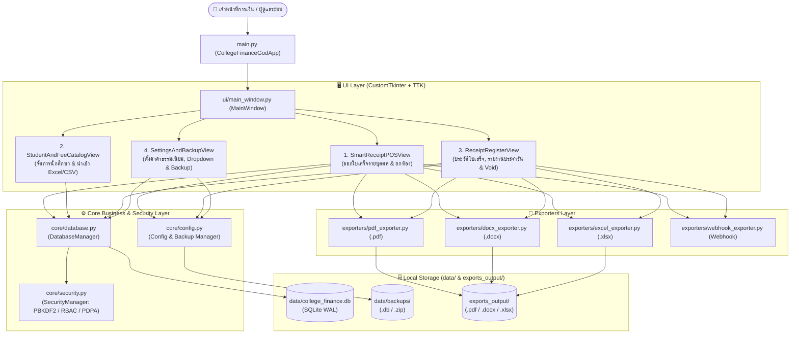
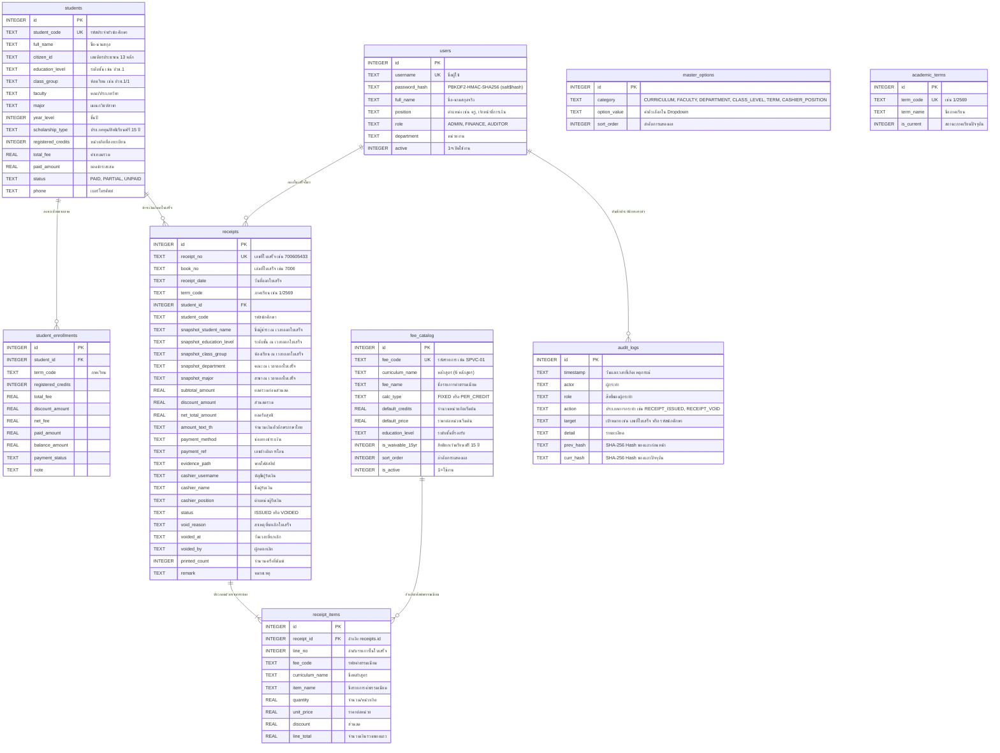

# 📘 เอกสารประกอบโครงการและคู่มือการใช้งานระบบ (Project Documentation & User Manual)
## ระบบออกใบเสร็จรับเงินค่าเทอม วิทยาลัยอาชีวศึกษาสุพรรณบุรี (SPVC Smart Receipt Desktop System)

เอกสารฉบับนี้รวบรวมข้อมูลสถาปัตยกรรมระบบ เทคโนโลยีที่ใช้ (Tech Stack) โครงสร้างโปรเจค (Project Structure) โครงสร้างและตำแหน่งฐานข้อมูล (Database Architecture) ระบบความปลอดภัย (Security) ตลอดจนคู่มือการใช้งานโปรแกรมฉบับสมบูรณ์ (User Manual)

---

## 📑 สารบัญ (Table of Contents)
1. [ภาพรวมของโปรเจค (Project Overview)](#1-ภาพรวมของโปรเจค-project-overview)
2. [เทคโนโลยีและไลบรารีที่ใช้ (Tech Stack)](#2-เทคโนโลยีและไลบรารีที่ใช้-tech-stack)
3. [โครงสร้างโปรเจค (Project Structure)](#3-โครงสร้างโปรเจค-project-structure)
4. [ระบบฐานข้อมูล โครงสร้างตาราง และตำแหน่งที่ตั้ง (Database Architecture)](#4-ระบบฐานข้อมูล-โครงสร้างตาราง-และตำแหน่งที่ตั้ง-database-architecture)
5. [ระบบความปลอดภัยและการตรวจสอบย้อนหลัง (Security & Compliance)](#5-ระบบความปลอดภัยและการตรวจสอบย้อนหลัง-security--compliance)
6. [คู่มือการใช้งานโปรแกรมฉบับสมบูรณ์ (User Manual)](#6-คู่มือการใช้งานโปรแกรมฉบับสมบูรณ์-user-manual)
7. [การแก้ไขปัญหาเบื้องต้น (Troubleshooting & FAQ)](#7-การแก้ไขปัญหาเบื้องต้น-troubleshooting--faq)

---

## 1. ภาพรวมของโปรเจค (Project Overview)

**CollegeFinanceGodApp (SPVC Smart Tuition & Flexible Receipt System)** เป็นแอปพลิเคชันแบบ Desktop สำหรับระบบปฏิบัติการ Windows พัฒนาขึ้นเพื่อรองรับงานการเงินและบัญชีของ **วิทยาลัยอาชีวศึกษาสุพรรณบุรี (อศ.สุพรรณบุรี)** โดยมีเป้าหมายหลักคือ:
- ออกใบเสร็จรับเงินค่าเทอมได้ทั้งแบบ **รายบุคคล** และ **แบบเดียวยกห้องเรียน (Batch Classroom Receipts)**
- รองรับการนำเข้ารายชื่อนักเรียน/นักศึกษาจากไฟล์ **Excel (`.xlsx`)** และ **CSV (`.csv`)**
- ส่งออกเอกสารใบเสร็จและรายงานสรุปยอดประจำวันในรูปแบบ **PDF (`.pdf`)**, **Word (`.docx`)** และ **Excel (`.xlsx`)**
- ปรับแต่งรายการค่าธรรมเนียมและตัวเลือก Dropdown ทุกหมวดได้เองผ่านหน้าจอตั้งค่าโดยไม่ต้องแก้ไขโค้ด
- มีความเสถียรและปลอดภัยสูงด้วยฐานข้อมูล **SQLite โหมด WAL (ACID)** พร้อมระบบ **Hash Chain Audit Log** และการสำรองข้อมูลอัตโนมัติ

---

## 2. เทคโนโลยีและไลบรารีที่ใช้ (Tech Stack)

โปรเจคนี้พัฒนาด้วยภาษา **Python 3** โดยแบ่งชุดเทคโนโลยีตามหน้าที่การทำงานดังนี้:

| หมวดหมู่ | เทคโนโลยี / ไลบรารี | ใช้สำหรับทำอะไรในโปรเจคนี้ | ไฟล์ที่เรียกใช้งานหลัก |
| :--- | :--- | :--- | :--- |
| **Core Language** | **Python 3.x** | ภาษาหลักในการพัฒนา Business Logic, การคำนวณเงิน, และการแปลงจำนวนเงินเป็นตัวอักษรภาษาไทย (`thai_baht_text`) | ทุกไฟล์ในโปรเจค |
| **Desktop GUI** | **CustomTkinter (`customtkinter`)** | สร้างส่วนติดต่อผู้ใช้ (UI) แบบ Modern Corporate (โทนสี Navy & Slate) เช่น หน้าต่างหลัก, ปุ่มกด, Dropdown (`CTkOptionMenu`), ช่องกรอกข้อมูล (`CTkEntry`), แท็บ (`CTkTabview`), และหน้าต่างป๊อปอัป (`CTkToplevel`) | `ui/main_window.py`, `ui/views.py`, `ui/login_window.py`, `ui/theme.py` |
| **Data Table UI** | **Tkinter TTK (`tkinter.ttk`)** | สร้างตารางแสดงผลข้อมูลความเร็วสูง (`ttk.Treeview` ในคลาส `DataTable`) พร้อมแถบเลื่อนแนวตั้ง/แนวนอน และการไฮไลต์สีตามสถานะใบเสร็จ | `ui/components.py` |
| **Primary Database** | **SQLite 3 (`sqlite3`)** | ระบบฐานข้อมูลหลักแบบ Serverless ตั้งค่าเป็นโหมด **WAL (Write-Ahead Logging)** รองรับ ACID Transaction และข้อมูลหลายแสนรายการโดยไม่ต้องติดตั้งโปรแกรมฐานข้อมูลแยก | `core/database.py`, `core/config.py` |
| **Enterprise DB (Optional)** | **PostgreSQL (`psycopg2`)** | รองรับการสลับไปใช้ฐานข้อมูล PostgreSQL ผ่านค่า `database_url` ใน `config.json` สำหรับการขยายระบบแบบ Client-Server | `core/database.py` |
| **PDF Generator** | **FPDF2 (`fpdf`)** | สร้างไฟล์ใบเสร็จรับเงินราชการ (`.pdf`) ตามแบบฟอร์มจริงของวิทยาลัยฯ (`EXofBill`: มีตราครุฑ, ในราชการกรมอาชีวศึกษา กระทรวงศึกษาธิการ, เลขที่, ที่ทำการ, วันที่ พ.ศ., ได้รับเงินจาก, รหัสประจำตัว, ภาค/ปีการศึกษา, คณะ, แผนกวิชา, ชั้น, รายการ, จำนวนเงิน, ยอดรวมตัวอักษร `ไว้เป็นการถูกต้องแล้ว` และลายมือชื่อผู้รับเงิน) รวมถึงใบเสร็จยกห้องหลายหน้า และรายงานสรุปยอดประจำวัน | `exporters/pdf_exporter.py` |
| **Word Generator** | **python-docx (`docx`)** | สร้างไฟล์ใบเสร็จรับเงินตามแบบฟอร์ม `EXofBill` และรายงานสรุปยอดประจำวันในรูปแบบเอกสาร Microsoft Word (`.docx`) ที่สามารถเปิดแก้ไขต่อได้ | `exporters/docx_exporter.py` |
| **Excel I/O** | **OpenPyXL (`openpyxl`)** | **ขานำเข้า:** อ่านไฟล์ `.xlsx` เพื่อนำเข้ารายชื่อนักศึกษาจำนวนมาก<br>**ขาส่งออก:** สร้างรายงานการเงิน `.xlsx` แบบ 3 ชีต (General Ledger, Student Tuition, Department Budgets) พร้อมจัดรูปแบบสีและตาราง | `core/database.py`, `exporters/excel_exporter.py` |
| **CSV Processing** | **`csv` (Standard Lib)** | อ่านและนำเข้าข้อมูลนักศึกษาจากไฟล์ `.csv` (รองรับการเข้ารหัส `utf-8-sig` เพื่อแสดงภาษาไทยใน Excel ได้ไม่เพี้ยน) | `core/database.py` |
| **Security & Crypto** | **`hashlib`, `os`, `re`** | เข้ารหัสรหัสผ่านด้วยอัลกอริทึม `PBKDF2-HMAC-SHA256` (120,000 รอบ), สร้าง `SHA-256` Hash Chain สำหรับ Audit Log และทำ PDPA Data Masking | `core/security.py`, `core/database.py` |
| **Backup & Archive** | **`zipfile`, `shutil`, `sqlite3.backup`** | สำรองฐานข้อมูลแบบ Online Hot Backup (`.db`) และบีบอัดฐานข้อมูลพร้อมโฟลเดอร์หลักฐานเป็นไฟล์ `.zip` | `core/config.py` |
| **Webhook / Alert** | **`urllib.request`, `threading`** | ส่งแจ้งเตือนธุรกรรมทางการเงินแบบทำงานเบื้องหลัง (Asynchronous Non-blocking Thread) ไปยัง Webhook ของ n8n, LINE Bot หรือ Discord | `exporters/webhook_exporter.py` |
| **Build & Packaging** | **PyInstaller** | แพ็กเกจโค้ด Python และไลบรารีทั้งหมดเป็นไฟล์ `.exe` (`SPVC_Receipt_App.exe` / `CollegeFinanceGodApp.spec`) สำหรับเปิดใช้งานบน Windows ทันที | `CollegeFinanceGodApp.spec` |
| **Testing** | **`unittest`, `Pillow (PIL)`** | ชุดทดสอบระบบอัตโนมัติ (Automated Unit & Integration Testing) ทดสอบทั้งการคำนวณเงิน, ออกใบเสร็จ, ยกเลิกใบเสร็จ, นำเข้าไฟล์ และสำรองข้อมูล | `test_suite.py` |

---

## 3. โครงสร้างโปรเจค (Project Structure)

```text
CollegeFinanceGodApp/
├── main.py                        # จุดเริ่มต้นการทำงานของโปรแกรม (Application Entry Point & Controller)
├── config.json                    # ไฟล์ตั้งค่าระบบ (ชื่อสถานศึกษา, เล่มที่/ช่วงเลขที่ใบเสร็จ, โฟลเดอร์ส่งออก ฯลฯ)
├── Run_SPVC_Receipt.bat           # ไฟล์ Batch สำหรับดับเบิลคลิกเปิดโปรแกรมบน Windows
├── SPVC_Receipt_App.exe           # ไฟล์ Executable (.exe) สำหรับเปิดโปรแกรมโดยตรงหรือทำ Shortcut บน Desktop
├── CollegeFinanceGodApp.spec      # ไฟล์ตั้งค่าสำหรับสั่ง Build โปรแกรมเป็น .exe ด้วย PyInstaller
├── test_suite.py                  # ชุดทดสอบระบบอัตโนมัติ (Unit & Integration Tests)
├── README.md                      # เอกสารแนะนำโปรเจคฉบับย่อ
├── DOCUMENTATION.md               # เอกสารประกอบโครงการและคู่มือการใช้งานฉบับสมบูรณ์ (ไฟล์นี้)
│
├── core/                          # 📦 โมดูลหลักด้านฐานข้อมูล ความปลอดภัย และการตั้งค่า (Backend Core)
│   ├── __init__.py
│   ├── config.py                  # โหลด/บันทึก config.json, แปลงเลขเป็นคำอ่านบาทไทย, สำรองและกู้คืนฐานข้อมูล
│   ├── database.py                # DatabaseManager: จัดการ SQLite WAL, CRUD นักศึกษา, ออกใบเสร็จ, Audit Log
│   ├── models.py                  # Data Models (UserSession, StudentRecord, TransactionRecord)
│   └── security.py                # SecurityManager: PBKDF2 Password Hashing, RBAC Permissions, PDPA Masking
│
├── ui/                            # 🖥️ โมดูลส่วนติดต่อผู้ใช้งาน (Frontend Desktop GUI)
│   ├── __init__.py
│   ├── theme.py                   # AppTheme: กำหนดโทนสี (Corporate Navy & Slate), ฟอนต์ Tahoma และสถานะภาษาไทย
│   ├── components.py              # Reusable UI Widgets: StatCard, SectionHeader, DataTable (Treeview)
│   ├── login_window.py            # LoginWindow: หน้าจอเข้าสู่ระบบและสลับบัญชีเจ้าหน้าที่
│   ├── main_window.py             # MainWindow: หน้าต่างหลักพร้อมแถบเมนูด้านซ้าย (Sidebar) 4 เมนูหลัก
│   └── views.py                   # หน้าจอการทำงานทั้ง 4 หน้า:
│                                  #   1. SmartReceiptPOSView (หน้าออกใบเสร็จรายบุคคล & ยกห้อง)
│                                  #   2. StudentAndFeeCatalogView (หน้าจัดการรายชื่อนักศึกษา & นำเข้า Excel/CSV)
│                                  #   3. ReceiptRegisterView (หน้าประวัติใบเสร็จ, รายงานประจำวัน & ยกเลิกใบเสร็จ)
│                                  #   4. SettingsAndBackupView (หน้าตั้งค่าค่าธรรมเนียม, Dropdown & สำรองข้อมูล)
│
├── exporters/                     # 📄 โมดูลส่งออกเอกสารและแจ้งเตือน (Document & Report Exporters)
│   ├── __init__.py
│   ├── base.py                    # BaseFinanceExporter: Abstract Base Class สำหรับตัวส่งออกรายงาน
│   ├── pdf_exporter.py            # PdfReceiptExporter: สร้างใบเสร็จรับเงินและรายงานประจำวันเป็นไฟล์ .pdf
│   ├── docx_exporter.py           # DocxReceiptExporter: สร้างใบเสร็จรับเงินและรายงานประจำวันเป็นไฟล์ .docx
│   ├── excel_exporter.py          # ExcelFinanceExporter: สร้างรายงานสรุปการเงินและลูกหนี้เป็นไฟล์ .xlsx (3 ชีต)
│   └── webhook_exporter.py        # FinanceWebhookDispatcher: ส่งแจ้งเตือนเข้า Webhook (n8n / LINE / Discord)
│
├── data/                          # 🗄️ โฟลเดอร์เก็บฐานข้อมูลและไฟล์สำรอง
│   ├── college_finance.db         # ไฟล์ฐานข้อมูลหลัก (SQLite 3 Database)
│   ├── backups/                   # โฟลเดอร์เก็บไฟล์สำรองฐานข้อมูล (.db และ .zip)
│   └── evidence/                  # โฟลเดอร์เก็บรูปภาพหลักฐาน/สลิปการโอนเงิน
│
├── exports_output/                # 📂 โฟลเดอร์เริ่มต้นสำหรับบันทึกไฟล์ใบเสร็จ (.pdf, .docx) และรายงาน (.xlsx)
└── EX/                            # 🖼️ โฟลเดอร์ภาพตัวอย่างหน้าจอและใบเสร็จต้นฉบับของวิทยาลัยฯ สำหรับอ้างอิง
```

### แผนผังการทำงานของระบบ (System Architecture Diagram)



---

## 4. ระบบฐานข้อมูล โครงสร้างตาราง และตำแหน่งที่ตั้ง (Database Architecture)

### 4.1 ฐานข้อมูลอยู่ที่ไหน? (Database Location)
ข้อมูลทั้งหมดถูกจัดเก็บไว้ภายในเครื่องคอมพิวเตอร์ (Local Storage) โดยไม่ต้องพึ่งพาอินเทอร์เน็ต ตามตำแหน่งต่อไปนี้:
1. **ไฟล์ฐานข้อมูลหลัก**:
   - พาธเต็ม: `D:\111Work\1111111\CollegeFinanceGodApp\data\college_finance.db`
   - ชนิดฐานข้อมูล: **SQLite 3** (สร้างตารางและข้อมูลเริ่มต้นให้อัตโนมัติเมื่อเปิดโปรแกรมครั้งแรก)
2. **โฟลเดอร์เก็บไฟล์สำรองฐานข้อมูล (Backups)**:
   - พาธเต็ม: `D:\111Work\1111111\CollegeFinanceGodApp\data\backups\`
   - เก็บไฟล์สำรองอัตโนมัติเมื่อปิดโปรแกรม (`spvc_receipt_backup_YYYYMMDD_HHMMSS.db`) และไฟล์สำรองแบบเต็ม (`SPVC_FullBackup_YYYYMMDD_HHMMSS.zip`)
3. **โฟลเดอร์เก็บหลักฐานการชำระเงิน (Evidence)**:
   - พาธเต็ม: `D:\111Work\1111111\CollegeFinanceGodApp\data\evidence\`

### 4.2 การปรับจูนประสิทธิภาพฐานข้อมูล (SQLite PRAGMA Optimization)
ทุกครั้งที่มีการเชื่อมต่อฐานข้อมูลใน `DatabaseManager._connect()` ระบบจะสั่งตั้งค่า SQLite ดังนี้:
- `PRAGMA foreign_keys = ON;` — บังคับใช้ความสัมพันธ์ของตาราง (Foreign Key Constraints) เช่น เมื่อลบใบเสร็จหลัก รายการย่อยจะถูกลบตามอัตโนมัติ (`ON DELETE CASCADE`)
- `PRAGMA journal_mode = WAL;` — เปิดโหมด **Write-Ahead Logging** ช่วยให้อ่านและเขียนข้อมูลพร้อมกันได้อย่างรวดเร็ว ป้องกันปัญหา `database is locked` และป้องกันข้อมูลสูญหายหากไฟดับ
- `PRAGMA synchronous = NORMAL;` — เพิ่มความเร็วในการเขียนข้อมูลลงดิสก์โดยยังคงความปลอดภัยของธุรกรรมในโหมด WAL
- `PRAGMA cache_size = -64000;` — จัดสรรหน่วยความจำ Cache สูงสุด 64 MB เพื่อการค้นหาและกรองข้อมูลที่รวดเร็วทันใจ
- `PRAGMA temp_store = MEMORY;` — เก็บตารางชั่วคราวสำหรับการจัดเรียงข้อมูลไว้ใน RAM

### 4.3 โครงสร้างตารางฐานข้อมูล (Database Schema - 9 ตาราง)



---

## 5. ระบบความปลอดภัยและการตรวจสอบย้อนหลัง (Security & Compliance)

ระบบได้รับการออกแบบตามมาตรฐานความปลอดภัยสำหรับซอฟต์แวร์การเงินของสถานศึกษา โดยมีกลไกป้องกันข้อมูลดังนี้:

### 5.1 การเข้ารหัสรหัสผ่านมาตรฐานสากล (`PBKDF2-HMAC-SHA256`)
- ในไฟล์ `core/security.py` (`SecurityManager.hash_password`) รหัสผ่านของผู้ใช้งานจะไม่ถูกเก็บเป็นข้อความธรรมดา (Plaintext) เด็ดขาด
- ใช้ฟังก์ชัน **`PBKDF2-HMAC-SHA256`** ทำซ้ำถึง **`120,000` รอบ (Iterations)** ร่วมกับค่า **Salt แบบสุ่มขนาด 16 ไบต์ (`os.urandom(16)`)** เฉพาะตัวของแต่ละรหัสผ่าน
- เก็บลงฐานข้อมูลในรูปแบบ `<salt_hex>$<hash_hex>` ช่วยป้องกันการโจมตีแบบ Rainbow Table และ Brute Force

### 5.2 การกำหนดสิทธิ์ตามบทบาท (`RBAC - Role-Based Access Control`)
ระบบแบ่งสิทธิ์ผู้ใช้งานใน `ROLE_PERMISSIONS` ออกเป็น 3 ระดับ:
1. **`ADMIN` (หัวหน้างานการเงิน / ผู้ดูแลระบบ)**: มีสิทธิ์ครบทุกฟีเจอร์ รวมถึงการยกเลิกใบเสร็จ (`ledger.void`) และการตั้งค่าระบบ/ฐานข้อมูล (`settings.manage`)
2. **`FINANCE` (เจ้าหน้าที่การเงิน / ผู้รับชำระ)**: สามารถออกใบเสร็จรับเงิน จัดการข้อมูลนักศึกษา และดูรายงานประจำวันได้
3. **`AUDITOR` (ผู้ตรวจสอบภายใน)**: สิทธิ์อ่านอย่างเดียว (`*.view`) สำหรับตรวจสอบยอดเงิน ทะเบียนใบเสร็จ และ Audit Log โดยไม่สามารถแก้ไขหรือลบข้อมูลได้

### 5.3 ระบบบันทึกประวัติแบบลูกโซ่แฮช (`Tamper-Evident SHA-256 Hash Chain Audit Log`)
- ทุกกิจกรรมสำคัญ เช่น การออกใบเสร็จ (`RECEIPT_ISSUED`), การยกเลิกใบเสร็จ (`RECEIPT_VOID`), การเพิ่ม/แก้ไข/ลบนักศึกษา (`STUDENT_CREATE`, `STUDENT_UPDATE`, `STUDENT_DELETE`), การนำเข้าไฟล์ Excel (`STUDENT_BULK_IMPORT`), และการแก้ไขค่าธรรมเนียม (`FEE_UPSERT`) จะถูกบันทึกลงตาราง `audit_logs`
- แต่ละแถวจะนำข้อมูล (`timestamp|actor|role|action|target|detail|prev_hash`) มาคำนวณ **`SHA-256`** เพื่อสร้าง `curr_hash` ผูกต่อกันเป็นลูกโซ่ (คล้ายเทคโนโลยี Blockchain เริ่มจาก `GENESIS_0000000000000000`)
- มีฟังก์ชัน `DatabaseManager.verify_audit_integrity()` สำหรับตรวจสอบความสมบูรณ์ของลูกโซ่ หากมีผู้ไม่หวังดีแอบเปิดไฟล์ฐานข้อมูลเพื่อแก้ไขหรือลบประวัติในตาราง `audit_logs` โดยตรง ระบบจะตรวจพบทันทีว่า Hash ไม่ตรงกัน (`Chain broken` หรือ `Hash mismatch`)

### 5.4 ความปลอดภัยของข้อมูลทางการเงิน (Financial Data Integrity)
- **Parameterized SQL Queries (`?`)**: คำสั่ง SQL ทั้งหมดในระบบใช้การผูกตัวแปร (Bound Parameters) ป้องกันช่องโหว่ **SQL Injection 100%**
- **Receipt Snapshot Isolation**: เมื่อออกใบเสร็จ ตาราง `receipts` จะบันทึก Snapshot ของชื่อผู้ชำระ ระดับชั้น ห้องเรียน และสาขาวิชา ณ เวลานั้นไว้ในใบเสร็จโดยตรง แม้ในอนาคตนักศึกษาจะเลื่อนชั้นหรือย้ายสาขา ข้อมูลในใบเสร็จเก่าที่เคยออกไปแล้วยังคงถูกต้องตามประวัติจริง
- **ห้ามลบใบเสร็จ แต่ใช้การยกเลิก (`VOID`) พร้อมระบุเหตุผล**: เพื่อความโปร่งใสทางบัญชี ระบบไม่อนุญาตให้ลบเลขที่ใบเสร็จออกจากระบบ แต่ใช้วิธีเปลี่ยนสถานะเป็น `VOIDED` บันทึกชื่อผู้ยกเลิก วันเวลา และสาเหตุ พร้อมทั้ง **คำนวณคืนยอดค้างชำระให้แก่นักศึกษาโดยอัตโนมัติ**
- **การควบคุมช่วงเลขที่ใบเสร็จ**: ระบบตรวจสอบไม่ให้เลขที่ใบเสร็จเกินช่วงสิ้นสุด (`receipt_no_end`) ที่ตั้งค่าไว้ในเล่มใบเสร็จ
- **Atomic Bulk Import**: การนำเข้าไฟล์ Excel/CSV ใช้ `BEGIN TRANSACTION` หากมีแถวใดแถวหนึ่งผิดพลาด ระบบจะ `rollback()` ทั้งหมดเพื่อไม่ให้ข้อมูลเข้าครึ่งๆ กลางๆ

### 5.5 การคุ้มครองข้อมูลส่วนบุคคล (PDPA Compliance)
- มีฟังก์ชัน `SecurityManager.mask_citizen_id()` สำหรับปิดบังเลขบัตรประชาชน 13 หลัก (เช่น `1-7299-XXXXX-45-6`) และ `SecurityManager.mask_bank_account()` สำหรับปิดบังเลขบัญชีธนาคาร (เช่น `XXX-X-XX456-7`)

### 5.6 ระบบสำรองและกู้คืนข้อมูลนิรภัย (Auto-Backup & Safe Restore)
- **Auto Backup on Exit**: ทุกครั้งที่กดปิดโปรแกรม ระบบจะสำรองฐานข้อมูลแบบ Online Hot Backup เก็บไว้ในโฟลเดอร์ `data/backups/` อัตโนมัติ
- **Safe Restore Verification**: ก่อนทำการกู้คืนไฟล์ฐานข้อมูล (`restore_database`) ระบบจะ:
  1. ตรวจสอบ Header 16 ไบต์แรกว่าเป็นไฟล์ `SQLite format 3` ของจริงหรือไม่
  2. รันคำสั่ง `PRAGMA integrity_check;` เพื่อตรวจว่าไฟล์สำรองไม่เสียหาย
  3. สำรองฐานข้อมูลปัจจุบันเก็บไว้ก่อน 1 ชุดเสมอเผื่อฉุกเฉิน แล้วจึงเขียนทับและล้างไฟล์ `-wal` / `-shm`

---

## 6. คู่มือการใช้งานโปรแกรมฉบับสมบูรณ์ (User Manual)

### 6.1 วิธีเปิดโปรแกรม (Starting the Application)
ผู้ใช้งานสามารถเปิดโปรแกรมได้ 3 วิธี (เลือกวิธีใดวิธีหนึ่ง):
1. **วิธีที่สะดวกที่สุด**: ดับเบิลคลิกที่ไฟล์ **`SPVC_Receipt_App.exe`** ในโฟลเดอร์โปรเจค (สามารถคลิกขวาที่ไฟล์นี้ เลือก *Send to* ➔ *Desktop (create shortcut)* เพื่อสร้างไอคอนไว้บนหน้าจอ Desktop ได้)
2. **เปิดผ่านไฟล์ Batch**: ดับเบิลคลิกที่ไฟล์ **`Run_SPVC_Receipt.bat`**
3. **เปิดผ่านคำสั่ง Python (สำหรับนักพัฒนา)**:
   ```powershell
   python main.py
   ```

> **การเลือกผู้รับเงิน (Cashier Selector)**:
> ที่แถบเมนูสีกรมท่าด้านซ้ายมือ จะมีช่อง **`ผู้รับเงิน:`** สามารถคลิกเลือกชื่อเจ้าหน้าที่การเงินที่ปฏิบัติงานได้ทันที ชื่อที่เลือกจะไปปรากฏที่ช่องลงชื่อผู้รับเงินในใบเสร็จรับเงินทุกฉบับโดยอัตโนมัติ

---

### 6.2 หน้า 1: ออกใบเสร็จรับเงิน (`1. ออกใบเสร็จรับเงิน`)

หน้าจอนี้เป็นหน้าหลักสำหรับออกใบเสร็จรับเงิน แบ่งการทำงานเป็น **3 ขั้นตอนง่ายๆ** บนหน้าจอเดียว:

#### ก. การออกใบเสร็จรับเงินรายบุคคล (Individual Receipt)
1. **ขั้นตอนที่ 1 : เลือกนักศึกษาที่จะออกใบเสร็จ**
   - เลือก **`กรองห้องเรียน`** (เช่น `ปวช.1/1`) เพื่อกรองเฉพาะเด็กในห้องนั้น หรือเลือก `ทั้งหมด`
   - คลิกเลือกชื่อจาก Dropdown **`รายชื่อนักศึกษา`** ระบบจะดึง *ชื่อผู้ชำระ, รหัสนักศึกษา, คณะ, สาขา, ห้อง* มาใส่ในช่องด้านล่างให้อัตโนมัติ (หากเป็นผู้ชำระเงินภายนอก สามารถพิมพ์ชื่อและรหัสลงในช่องได้โดยตรง)
   - มุมขวาบนของกรอบขั้นตอนที่ 1 จะแสดง **`เลขที่ใบเสร็จ`** ถัดไปให้อัตโนมัติ (เช่น `700605434`), **`วันที่`** และ **`ภาคเรียน`** (สามารถแก้ไขได้หากต้องการออกใบเสร็จย้อนหลัง)
2. **ขั้นตอนที่ 2 : เพิ่มรายการค่าธรรมเนียม**
   - เลือก **`หลักสูตร`** จาก Dropdown (มี 6 หมวด ได้แก่ *หลักสูตรในระบบ-ปวช, หลักสูตรในระบบ-ปวส, หลักสูตรปริญญาตรี, ค่าวัสดุฝึกสำเร็จรูป, หลักสูตรระยะสั้น, อื่นๆ*)
   - เลือก **`รายการค่าธรรมเนียม`** ที่ต้องการ ระบบจะดึง **จำนวน** และ **ราคาต่อหน่วย** มาแสดงอัตโนมัติ (สามารถแก้ไขตัวเลขจำนวนหรือราคาได้ตามจริง)
   - กดปุ่ม **`➕ เพิ่มลงใบเสร็จ`** รายการจะถูกเพิ่มลงในตารางด้านล่าง พร้อมคำนวณยอดรวมสุทธิและคำอ่านภาษาไทยให้อัตโนมัติ (สามารถกดเพิ่มได้หลายรายการในใบเสร็จเดียว)
   - *หากต้องการลบรายการที่เลือกผิด*: คลิกแถวในตารางแล้วกดปุ่ม **`ลบแถวที่เลือก`** หรือกด **`ล้างตาราง`** เพื่อเริ่มใหม่
3. **ขั้นตอนที่ 3 : บันทึก & พิมพ์ใบเสร็จ**
   - เลือกช่องทางการชำระเงิน (`เงินสด (Cash)`, `สแกน QR PromptPay`, หรือ `โอนเข้าบัญชีวิทยาลัย`)
   - กดปุ่มสีน้ำเงิน **`🖨️ ขั้นตอนที่ 3: บันทึก & พิมพ์ใบเสร็จ (.pdf)`**
   - เลือกโฟลเดอร์ที่ต้องการบันทึกไฟล์ (สามารถเลือกนามสกุลไฟล์เป็น `.pdf` หรือ `.docx` ได้ในหน้าต่าง Save) แล้วกด **Save**

---

#### ข. การออกใบเสร็จแบบเดียวยกห้อง (`🏫 โหมดออกใบเสร็จยกห้อง / นำเข้าไฟล์ Excel`)
ใช้ในกรณีที่นักเรียนทั้งห้องชำระค่าธรรมเนียมรายการเดียวกัน (เช่น ค่าบำรุงการศึกษาต้นเทอม) เพื่อไม่ต้องคีย์ทีละคน:
1. ในหน้า **1. ออกใบเสร็จรับเงิน** ให้ทำ **ขั้นตอนที่ 2** ก่อน คือเลือกรายการค่าธรรมเนียมแล้วกด **`➕ เพิ่มลงใบเสร็จ`** จนได้รายการและยอดเงินรวมต่อคนที่ต้องการในตาราง
2. กดปุ่มมุมขวาบน **`🏫 โหมดออกใบเสร็จยกห้อง / นำเข้าไฟล์ Excel`** จะมีหน้าต่างป๊อปอัปขึ้นมาให้เลือก 2 วิธี:
   - **วิธีที่ 1 (เลือกห้องเรียนที่มีในระบบ)**: เลือกห้องเรียนจาก Dropdown (เช่น `ปวช.1/1`) แล้วกดปุ่ม **`🖨️ ออกใบเสร็จทั้งห้อง & สร้างไฟล์ PDF (.pdf)`** ระบบจะรันเลขที่ใบเสร็จเรียงต่อกันให้เด็กทุกคนในห้องนั้น และสร้างไฟล์ PDF/Word ที่แบ่งหน้าละ 1 คนรวมอยู่ในไฟล์เดียวพร้อมสั่งพิมพ์ทันที
   - **วิธีที่ 2 (นำเข้าไฟล์ Excel/CSV รายชื่อเด็กแล้วออกใบเสร็จทันที)**: กดปุ่ม **`📥 เลือกไฟล์ Excel/CSV รายชื่อเด็ก ➔ ออกใบเสร็จยกห้องทันที`** เลือกไฟล์ `.xlsx` หรือ `.csv` ระบบจะนำเข้ารายชื่อเด็กเข้าฐานข้อมูลและออกใบเสร็จให้เด็กทุกคนในไฟล์นั้นทันทีในคลิกเดียว

---

### 6.3 หน้า 2: รายชื่อนักศึกษา (`2. รายชื่อนักศึกษา`)

ใช้สำหรับค้นหา เพิ่ม แก้ไข ลบ และนำเข้าข้อมูลพื้นฐานของนักเรียน/นักศึกษา:
- **การค้นหาและกรองข้อมูล (แถบด้านบน)**:
  - เลือก Dropdown **`กรองสาขา`** หรือ **`กรองห้องเรียน`** หรือพิมพ์รหัส/ชื่อในช่อง **`🔍 ค้นหารหัสนักศึกษา หรือ ชื่อ-นามสกุล...`** ตารางจะกรองข้อมูลแบบ Real-time
- **การเพิ่มนักศึกษาใหม่ (แถบด้านล่าง)**:
  - กรอก `รหัสนักศึกษา`, `ชื่อ-สกุล` และเลือก `คณะ`, `สาขา`, `ห้อง` จาก Dropdown
  - กดปุ่ม **`💾 บันทึกข้อมูลนักศึกษา (เพิ่มใหม่ / อัปเดต)`**
- **การแก้ไขข้อมูลนักศึกษา**:
  - คลิกเลือกแถวรายชื่อนักศึกษาในตาราง ข้อมูลจะเด้งลงมาในช่องกรอกด้านล่าง
  - แก้ไขข้อมูลที่ต้องการ แล้วกดปุ่ม **`💾 บันทึกข้อมูลนักศึกษา (เพิ่มใหม่ / อัปเดต)`**
- **การลบรายชื่อนักศึกษา**:
  - คลิกเลือกแถวรายชื่อในตาราง แล้วกดปุ่มสีแดง **`🗑 ลบรายชื่อนี้`** มุมขวาล่าง
- **การนำเข้ารายชื่อจากไฟล์ Excel / CSV (`📥 นำเข้ารายชื่อจากไฟล์ Excel / CSV`)**:
  - กดปุ่ม **`📥 นำเข้ารายชื่อจากไฟล์ Excel / CSV`** มุมขวาบน แล้วเลือกไฟล์ `.xlsx` หรือ `.csv`
  - **ลำดับคอลัมน์ในไฟล์ Excel/CSV ที่รองรับ** (แถวแรกเป็นหัวตารางได้ ระบบจะข้ามหัวตารางให้อัตโนมัติ):
    1. `รหัสนักศึกษา` (จำเป็นต้องมี)
    2. `ชื่อ-นามสกุล` (จำเป็นต้องมี)
    3. `เลขบัตรประชาชน` (เว้นว่างได้)
    4. `คณะ` (ถ้าเว้นว่างจะใช้ค่าเริ่มต้นที่เลือกไว้)
    5. `สาขาวิชา` (ถ้าเว้นว่างจะใช้ค่าเริ่มต้นที่เลือกไว้)
    6. `ชั้นปี` (ตัวเลข เช่น `1`, `2`, `3`)
    7. `ประเภททุน/สิทธิ` (เช่น `ปกติ (Regular)`, `เรียนฟรี 15 ปี (ปวช.)`)
    8. `ค่าเทอมรวม` (ตัวเลข เช่น `950`)
    9. `เบอร์โทรศัพท์` (เว้นว่างได้)
    10. `ระดับชั้น` (เช่น `ปวช.1`)
    11. `ห้องเรียน` (เช่น `ปวช.1/1`)

---

### 6.4 หน้า 3: ประวัติใบเสร็จ, รายงานประจำวัน & ยกเลิกใบเสร็จ (`3. ประวัติ & ยกเลิกใบเสร็จ`)

ใช้สำหรับตรวจสอบประวัติใบเสร็จที่ออกไปแล้ว พิมพ์ใบเสร็จซ้ำ พิมพ์รายงานส่งการเงินประจำวัน และยกเลิกใบเสร็จที่คีย์ผิด:
1. **การดูสรุปยอดรับชำระตามวันที่**:
   - เลือก **`📅 วันที่ออกใบเสร็จ`** จาก Dropdown ด้านบน (หรือเลือก `ทั้งหมด`)
   - มุมขวาบนของตารางจะสรุป **`ยอดรับสุทธิ: ฿X,XXX.XX บาท (จำนวนฉบับ)`** เฉพาะใบเสร็จที่สถานะปกติ (ไม่รวมใบเสร็จที่ยกเลิก)
2. **การพิมพ์รายงานสรุปยอดประจำวัน (`.pdf` / `.docx`)**:
   - เลือกวันที่ที่ต้องการ แล้วกดปุ่ม **`🖨️ พิมพ์รายงานประจำวัน (.pdf)`** มุมขวาบน
   - ระบบจะสร้างใบสรุปยอดประจำวัน แยกตามช่องทางการชำระเงิน และแยกตามหมวดรายการค่าธรรมเนียม พร้อมช่องลงลายมือชื่อผู้รับเงิน
3. **การส่งออกรายงาน Excel รวม (`📊 ส่งออกรายงาน Excel`)**:
   - กดปุ่ม **`📊 ส่งออกรายงาน Excel`** มุมขวาบน ระบบจะสร้างไฟล์ `.xlsx` ประกอบด้วย 3 ชีต ได้แก่ *General Ledger*, *Student Tuition* และ *Department Budgets*
4. **การพิมพ์ใบเสร็จซ้ำ (Reprint)**:
   - คลิกเลือกแถวใบเสร็จที่ต้องการในตาราง (เลขที่ใบเสร็จจะปรากฏในช่อง `เลขที่ใบเสร็จ` ด้านล่าง)
   - กดปุ่ม **`🖨️ พิมพ์ใบเสร็จใบนี้ซ้ำ (.pdf)`**
5. **การยกเลิกใบเสร็จ (`🚫 ยกเลิกใบเสร็จนี้ (Void)`)**:
   - คลิกเลือกใบเสร็จที่ต้องการยกเลิกในตาราง (หรือพิมพ์เลขที่ใบเสร็จในช่องด้านล่าง)
   - ระบุ **`สาเหตุยกเลิก`** (เช่น *รายการคลาดเคลื่อน / ออกใบเสร็จใหม่*)
   - กดปุ่มสีแดง **`🚫 ยกเลิกใบเสร็จนี้ (Void)`** และกดยืนยัน
   - แถวใบเสร็จจะเปลี่ยนเป็นสีแดง (`ยกเลิกแล้ว`) ยอดเงินของใบเสร็จนั้นจะถูกหักออกจากยอดรวมประจำวัน และคืนยอดค้างชำระให้นักศึกษาอัตโนมัติ

---

### 6.5 หน้า 4: ตั้งค่าระบบ (`4. ตั้งค่าระบบ`)

แบ่งออกเป็น **3 แท็บย่อย** เพื่อให้เจ้าหน้าที่ปรับแต่งระบบได้เอง 100%:

#### แท็บที่ 1 : `1. รายการค่าธรรมเนียม (ตามหลักสูตร)`
- เลือก **`เลือกหลักสูตร`** ด้านบนเพื่อดูรายการค่าธรรมเนียมในหลักสูตรนั้นๆ
- **หากต้องการเพิ่มรายการใหม่**: เว้นช่องรหัสไว้ (หรือระบุรหัสเช่น `SPVC-36`), พิมพ์ `ชื่อรายการค่าธรรมเนียม`, พิมพ์ `ราคา (บาท)` แล้วกด **`💾 บันทึกรายการ`**
- **หากต้องการแก้ไขราคาหรือชื่อรายการ**: คลิกเลือกแถวในตาราง แก้ไขข้อมูลในช่องด้านล่าง แล้วกด **`💾 บันทึกรายการ`**
- **หากต้องการลบรายการ**: คลิกเลือกแถวในตาราง แล้วกดปุ่ม **`🗑 ลบ`**

#### แท็บที่ 2 : `2. เพิ่ม/ลบตัวเลือก Dropdown`
- เลือก **`เลือกหมวดหมู่ Dropdown`** ที่ต้องการจัดการ ได้แก่:
  - `หลักสูตร (CURRICULUM)`
  - `คณะ (FACULTY)`
  - `แผนกวิชา / สาขา (DEPARTMENT)`
  - `ชั้นปี / ห้องเรียน (CLASS_LEVEL)`
  - `ภาค / ปีการศึกษา (TERM)`
  - `ตำแหน่งผู้รับเงิน (CASHIER_POSITION)`
- พิมพ์ชื่อตัวเลือกใหม่ในช่องด้านล่าง แล้วกด **`➕ เพิ่มตัวเลือก`** หรือคลิกแถวที่ต้องการเอาออกแล้วกด **`🗑 ลบตัวเลือกนี้`**

#### แท็บที่ 3 : `3. เลขที่ใบเสร็จ & สำรองข้อมูล`
- **ฝั่งซ้าย (กำหนดข้อมูลใบเสร็จเบื้องต้น)**:
  - ตั้งค่า `ที่ทำการ (ชื่อสถานศึกษา)`, `ตำแหน่งผู้รับเงิน`, `เล่มที่ใบเสร็จ` (เช่น `7006`), `เลขที่ใบเสร็จตั้งแต่` (เช่น `700605433`) และ `ถึงใบเสร็จเลขที่` (เช่น `700611000`) แล้วกด **`💾 บันทึกการตั้งค่า`**
- **ฝั่งขวา (สำรองและกู้คืนฐานข้อมูล)**:
  - กดปุ่ม **`📦 สำรองข้อมูลเก็บไว้ (.zip Full Backup)`** เพื่อบันทึกไฟล์ฐานข้อมูลและรูปหลักฐานทั้งหมดเป็นไฟล์ `.zip` เก็บไว้ใน Flash Drive หรือ External Harddisk
  - กดปุ่ม **`♻️ กู้คืนฐานข้อมูลจากไฟล์สำรอง (.db)`** เพื่อนำไฟล์สำรอง `.db` กลับมาใช้งานในกรณีต้องการย้อนข้อมูล

---

## 7. การแก้ไขปัญหาเบื้องต้น (Troubleshooting & FAQ)

| ปัญหาที่พบ | สาเหตุ | วิธีแก้ไข |
| :--- | :--- | :--- |
| **กดออกใบเสร็จแล้วแจ้งเตือนว่า *"เลขที่ใบเสร็จเกินช่วงเลขที่ใบเสร็จสิ้นสุด"*** | เลขที่ใบเสร็จรันมาถึงเลขสุดท้ายของเล่มที่ตั้งค่าไว้ (เช่น เกิน `700611000`) | ไปที่เมนู **`4. ตั้งค่าระบบ`** ➔ แท็บ **`3. เลขที่ใบเสร็จ & สำรองข้อมูล`** ➔ ขยายตัวเลขในช่อง **`ถึงใบเสร็จเลขที่:`** หรือเปลี่ยนเล่มที่ใบเสร็จใหม่ แล้วกด **`💾 บันทึกการตั้งค่า`** |
| **เพิ่มห้องเรียนหรือสาขาใหม่ในหน้าตั้งค่าแล้ว แต่ยังไม่เห็นในหน้าออกใบเสร็จ** | หน้าจอออกใบเสร็จโหลดตัวเลือกไว้ตั้งแต่ก่อนเพิ่ม | คลิกสลับไปเมนู **`1. ออกใบเสร็จรับเงิน`** อีกครั้ง หน้าจอจะรีเฟรชตัวเลือก Dropdown ล่าสุดจากฐานข้อมูลขึ้นมาแสดงทันที |
| **บันทึกไฟล์ PDF หรือ Word ไม่ได้ (Permission Denied)** | ไฟล์ใบเสร็จชื่อเดียวกันกำลังถูกเปิดค้างไว้ในโปรแกรม Adobe Reader หรือ Microsoft Word | ปิดไฟล์ PDF/Word เดิมที่เปิดค้างอยู่ก่อน หรือเปลี่ยนชื่อไฟล์ตอนกด Save |
| **ต้องการรันชุดทดสอบระบบ (Automated Test Suite) เพื่อเช็กความพร้อม** | ต้องการตรวจสอบว่าฐานข้อมูลและการสร้างไฟล์ PDF/Word/Excel ทำงานปกติหรือไม่ | เปิด Terminal ในโฟลเดอร์โปรเจคแล้วรันคำสั่ง `python test_suite.py` หากขึ้น `OK` แสดงว่าระบบสมบูรณ์ 100% |
